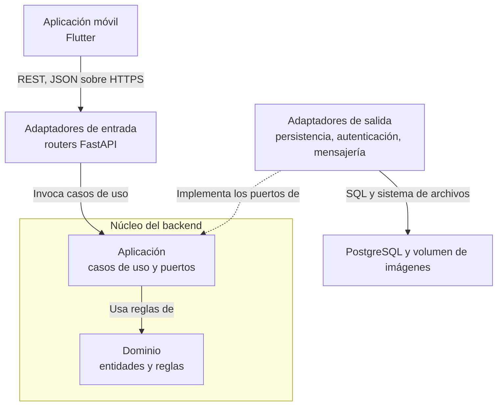

# 5. Vista de bloques

## 5.1 Nivel 1: Sistema

LinkClub se compone de dos contenedores propios, la aplicación móvil (**Flutter**) y la API (**FastAPI**), y de dos almacenes: la base de datos **PostgreSQL 18** y un volumen persistente de imágenes. Los contenedores y sus relaciones están en [docs/c4/contexto.md](../c4/contexto.md).

El backend adopta la arquitectura hexagonal ([ADR 0001](../adr/0001-hexagonal.md)): el núcleo (dominio y aplicación) contiene la lógica de negocio y se comunica con el exterior mediante puertos y adaptadores. Las dependencias apuntan siempre hacia el núcleo.

## 5.2 Nivel 2: bloques del backend

Código ubicado en `backend/src/linkclub/`.

| Bloque | Ubicación | Responsabilidad | Estado |
| ------ | ------ | ------ | ------ |
| **Dominio** | `domain/` | Entidades `Club` y `Publicacion`, enumeración `TipoPublicacion` (`aviso`, `encuesta`, `noticia`) y excepciones de negocio (`ClubNoEncontrado`, `PublicacionDuplicada`). No depende de frameworks ni de base de datos. | Implementado |
| **Aplicación: casos de uso** | `application/use_cases/` | `CheckHealthUseCase`, `ListarClubesUseCase`, `ObtenerClubUseCase`, `CrearPublicacionUseCase` y `NotificarPublicacionCreada`. Coordinan el dominio y los puertos. | Implementado |
| **Aplicación: puertos** | `application/ports/` | Puertos de entrada (salud, clubes, publicaciones) y de salida (`StatusPort`, `ClubRepositoryPort`, `PublicacionRepositoryPort`, `AuthPort`, `PublicadorPort`, `OutboxPort`, `DeduplicacionPort`, `NotificadorPort`). | Implementado |
| **Aplicación: mensajería** | `application/messaging/` | Mensaje versionado `publicacion.creada`, validación de contrato, métricas y trazas estructuradas. | Prototipo verificado por pruebas |
| **Adaptadores de entrada** | `adapters/inbound/api/` | Routers `health_router`, `auth_router`, `usuario_router`, `club_router`, `publicacion_router`, `evento_router` y `recurso_router`, junto con `auth_dependency` (`require_auth`, `get_current_user`, `require_superadmin`). | Implementado (con desviaciones declaradas) |
| **Adaptador de autenticación** | `adapters/outbound/auth/` | `LocalJwtAuthAdapter`: verifica firma `HS256`, expiración (`exp`) y sujeto (`sub`) del token con `JWT_SECRET` obligatorio. | Implementado |
| **Adaptadores de persistencia (PostgreSQL)** | `adapters/outbound/postgres/` | `database.py`, modelos SQLAlchemy (`ClubModel`, `UsuarioModel`, `PublicacionModel`, `EventoModel`, `AsistenciaModel`, `SolicitudAdminClubModel`), `PublicacionRepositoryPostgres` y `PostgresStatusAdapter` (`SELECT 1`). | Implementado |
| **Adaptadores en memoria** | `adapters/outbound/persistence/` | `InMemoryDedup` (prototipo de mensajería) e `InMemoryClubAdapter` (conserva únicamente la constante `_SEMILLA` usada por `main.py` para inicializar los 5 clubes base en PostgreSQL). | Prototipo / semilla inicial |
| **Adaptadores de mensajería** | `adapters/outbound/messaging/` | `InMemoryBroker` e `InMemoryOutbox` con reintentos exponenciales (full jitter) y cola de mensajes fallidos (DLQ). | Prototipo verificado por `test_mensajeria.py` |

El detalle de las relaciones entre contextos está en [mapa-contextos-fundamentacion.md](./mapa-contextos-fundamentacion.md) y la propiedad de datos en [tabla_modulo.md](./tabla_modulo.md).

## 5.3 Desviaciones arquitectónicas declaradas

Para mantener simplicidad operativa dentro del alcance del proyecto ([ADR 0008](../adr/0008-no-extraer-publicaciones.md)), los routers de autenticación (`auth_router.py`), perfil y administración (`usuario_router.py`), consulta y edición de clubes (`club_router.py`), eventos/asistencia (`evento_router.py`) y listados de lectura de publicaciones (`publicacion_router.py`) interactúan directamente con la sesión `Session` de SQLAlchemy y los modelos ORM, en lugar de pasar por casos de uso y puertos dedicados. La lógica crítica de creación de publicaciones con idempotencia (`CrearPublicacionUseCase`) y la verificación de salud (`CheckHealthUseCase`) sí atraviesan el núcleo hexagonal completo.

## 5.4 Nivel 2: bloques de la aplicación móvil

Código ubicado en `frontend/linkclub/lib/`.

| Bloque | Ubicación | Responsabilidad |
| ------ | ------ | ------ |
| **Presentación** | `presentation/` | Pantallas `LoginScreen`, `SignUpScreen` (con solicitud opcional de admin), `ClubsPage` (navegación en 4 pestañas), `FeedScreen` (publicaciones y eventos próximos), `ConvocatoriasScreen`, `ClubsListScreen` (búsqueda y filtros por categoría), `ClubDetailPage` (ficha, edición, eventos y avisos), `CreatePublicationScreen`, `CreateEventScreen`, `SettingsScreen` (perfil, contraseña, modo vista estudiante) y `DevAdminScreen` (consola Superadmin). |
| **Datos** | `data/` | Repositorios `AuthRepository`, `ClubRepository`, `PublicationRepository` y `EventRepository`: traducen acciones de la UI a llamadas REST tipadas y mapean respuestas JSON. |
| **Sesión y Red** | `core/session/`, `core/network/` | `SessionController` (estado reactivo del usuario, permisos por rol y modo vista estudiante) y `ApiClient` (instancia única de `Dio` con interceptores para `Authorization: Bearer` e `Idempotency-Key` UUID v4 en cada `POST`). |
| **Tema** | `core/theme/` | `AppTheme` (paleta institucional Material 3 claro/oscuro y tipografía DM Sans) y `ThemeController`. |
| **Arranque** | `main.dart` | Carga variables `.env`, inicializa tema y valida el token almacenado en `flutter_secure_storage` contra `/usuarios/me` antes de dirigir a `ClubsPage` o `LoginScreen`. |