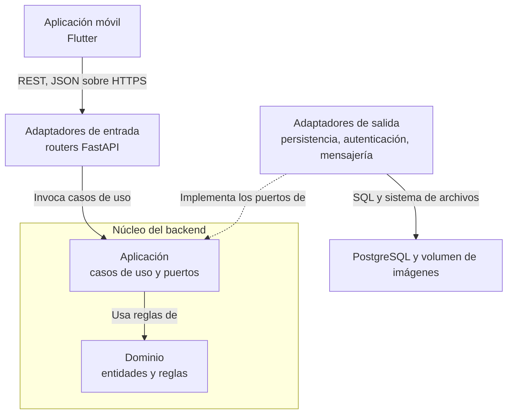

# 5. Vista de bloques

## 5.1 Nivel 1: Sistema

LinkClub se compone de dos contenedores propios, la aplicación móvil (Flutter) y la API (FastAPI), y de dos almacenes: la base de datos PostgreSQL y un volumen de imágenes. Los contenedores y sus relaciones están en [`docs/c4/contexto.md`](../c4/contexto.md).

El backend adopta la arquitectura hexagonal ([ADR 0001](../adr/0001-hexagonal.md)): el núcleo (dominio y aplicación) contiene la lógica de negocio y se comunica con el exterior mediante puertos y adaptadores. Las dependencias apuntan siempre hacia el núcleo.

## 5.2 Nivel 2: bloques del backend

Código en `backend/src/linkclub/`.

| Bloque | Ubicación | Responsabilidad | Estado |
|---|---|---|---|
| Dominio | `domain/` | Entidades `Club` y `Publicacion`, tipos de publicación (aviso, encuesta, noticia) y excepciones de negocio. No depende de frameworks ni de base de datos. | Implementado |
| Aplicación: casos de uso | `application/use_cases/` | `CheckHealthUseCase`, `ListarClubesUseCase`, `ObtenerClubUseCase`, `CrearPublicacionUseCase` y `NotificarPublicacionCreada`. Coordinan el dominio y los puertos. | Implementado |
| Aplicación: puertos | `application/ports/` | Puertos de entrada (salud, clubes, publicaciones) y de salida (autenticación, repositorios de clubes y publicaciones, estado, mensajería). | Implementado |
| Aplicación: mensajería | `application/messaging/` | Mensaje versionado `publicacion.creada`, validación de contrato, métricas y trazas. | Prototipo verificado por pruebas |
| Adaptadores de entrada | `adapters/inbound/api/` | Routers de salud, autenticación, clubes, publicaciones y recursos, y la dependencia de seguridad `require_auth`. | Implementado, con desviaciones |
| Adaptador de autenticación | `adapters/outbound/auth/` | `LocalJwtAuthAdapter`: verifica firma, expiración y sujeto del token. | Implementado |
| Adaptadores de persistencia (PostgreSQL) | `adapters/outbound/postgres/` | Sesión de base de datos, modelos SQLAlchemy y `PublicacionRepositoryPostgres`. | Implementado |
| Adaptadores en memoria | `adapters/outbound/persistence/` | Catálogo de clubes, estado de salud y deduplicación de mensajes. | Temporales |
| Adaptadores de mensajería | `adapters/outbound/messaging/` | Broker y outbox en memoria con reintentos y cola de mensajes fallidos. | Prototipo; sin endpoint que los invoque |

Componentes de persistencia sin uso en la API vigente: `in_memory_publicacion_adapter.py` y `postgres_publicacion_adapter.py`. Se registran como deuda técnica en la [Sección 11](./11_riesgos_y_deuda_tecnica.md).

## 5.3 Contextos delimitados y su ubicación en el código

| Contexto | Datos que administra | Código principal | Estado |
|---|---|---|---|
| Usuarios | Identidad, perfil, credenciales | `auth_router.py`, `auth_dependency.py`, `usuario_model.py`, `local_jwt_adapter.py` | Registro, inicio de sesión y validación de token |
| Clubes | Clubes y membresías | `club.py`, `consultar_clubes.py`, `club_router.py`, `in_memory_club_adapter.py` | Solo consulta, con datos en memoria |
| Publicaciones | Avisos, encuestas y noticias | `publicacion.py`, `crear_publicacion.py`, `publicacion_router.py`, `publicacion_repository.py` | Creación y listado con persistencia |

El detalle de las relaciones está en [`mapa-contextos-fundamentacion.md`](./mapa-contextos-fundamentacion.md) y la propiedad de datos en [`tabla_modulo.md`](./tabla_modulo.md).

## 5.4 Nivel 2: bloques de la aplicación móvil

Código en `frontend/linkclub/lib/`.

| Bloque | Ubicación | Responsabilidad |
|---|---|---|
| Presentación | `presentation/` | Pantallas de inicio de sesión, registro, feed, creación de publicaciones y navegación principal con catálogo de clubes. |
| Datos | `data/` | Repositorios de autenticación y de publicaciones: traducen las pantallas a llamadas HTTP. |
| Red | `core/network/` | Cliente HTTP único (Dio) con interceptores que agregan el token de sesión y una `Idempotency-Key` a cada `POST`. |
| Tema | `core/theme/` | Tema claro y oscuro (Material 3) y controlador de modo. |
| Arranque | `main.dart` | Carga de configuración y del tema, y decisión de pantalla inicial según exista un token guardado. |

El token de sesión se conserva en el almacenamiento seguro del dispositivo.

## 5.5 Reglas de dependencia

1. El dominio no importa nada de la aplicación ni de los adaptadores.
2. Los casos de uso dependen solo del dominio y de los puertos, nunca de un adaptador concreto.
3. Los adaptadores de entrada invocan casos de uso; los adaptadores de salida implementan puertos.
4. Los contextos se referencian por identidad (`club_id`, autor) y no copian datos ajenos.

Desviaciones vigentes de las reglas 2 y 3: los routers de autenticación, listados de publicaciones y carga de imágenes acceden directamente a la sesión de base de datos o al sistema de archivos. Están detalladas en el diagrama de componentes ([`docs/c4/contexto.md`](../c4/contexto.md)) y se tratan como deuda técnica.