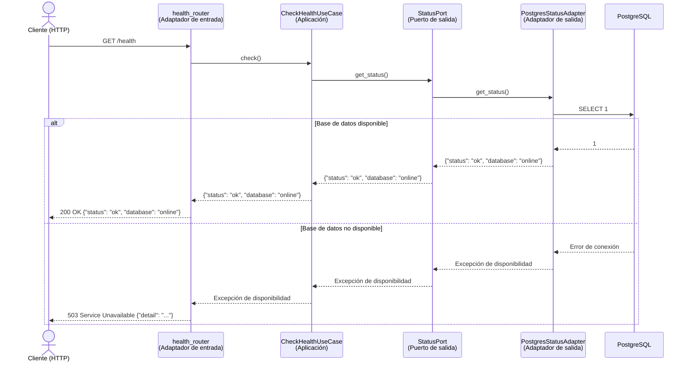
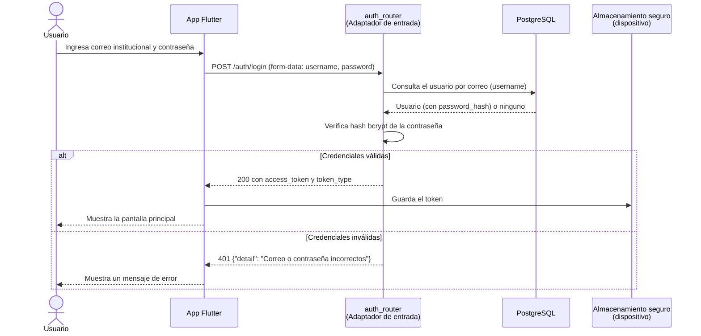
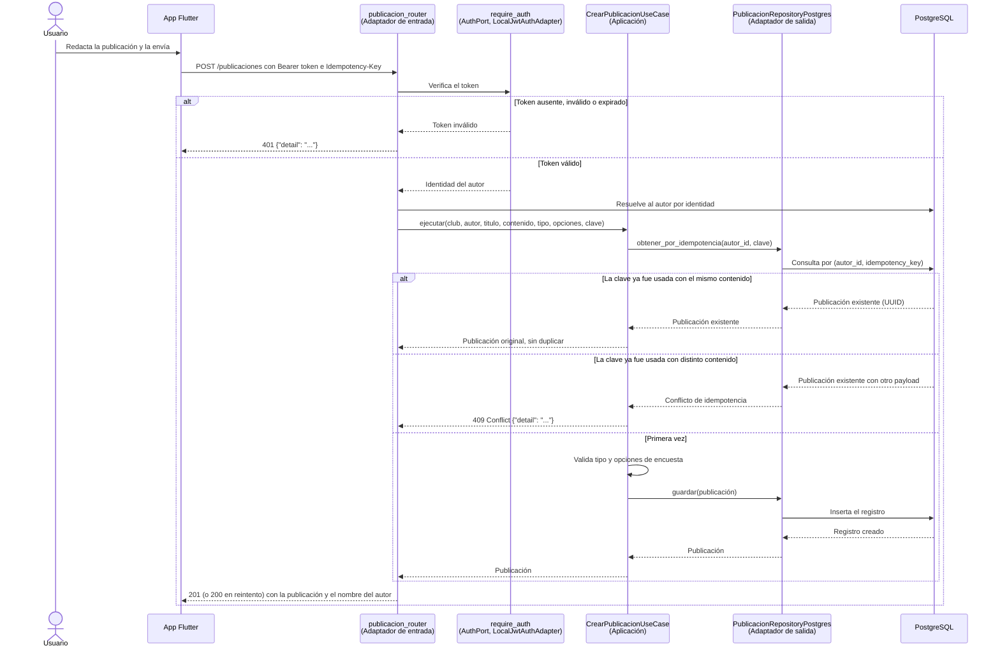

# 6. Vista de ejecución

Esta sección documenta, mediante diagramas de secuencia, cómo se comporta **LinkClub** en tiempo de ejecución en los tres recorridos que hoy están implementados de extremo a extremo: consulta de estado, inicio de sesión y creación de una publicación.

## 6.1. Escenario: consulta de estado (`GET /health`)

1. El cliente envía `GET /health` a la API.
2. El adaptador de entrada (`health_router.py`) delega en el caso de uso, sin lógica de negocio propia.
3. `CheckHealthUseCase` llama a `get_status()` sobre el puerto `StatusPort`; solo conoce la interfaz.
4. `PostgresStatusAdapter` ejecuta `SELECT 1` contra PostgreSQL para verificar la conectividad real.
5. Si la base responde, devuelve `200 OK {"status": "ok", "database": "online"}`; si falla, responde de forma controlada con `503 Service Unavailable`.

Cubierto por [`backend/tests/test_health.py`](../../backend/tests/test_health.py).

## 6.2. Escenario: inicio de sesión (`POST /auth/login`)

1. La app valida en el formulario que el correo termine en `@utb.edu.co` y envía las credenciales bajo el estándar `OAuth2PasswordRequestForm` (`username` y `password`).
2. La API busca al usuario por correo, verifica el hash `bcrypt` de la contraseña y emite un token JWT HS256 firmado con `JWT_SECRET` (vigencia por defecto de 7 días) cuyo sujeto es la matrícula.
3. La app guarda el token en almacenamiento seguro; un interceptor lo agrega como cabecera `Authorization: Bearer` en las peticiones siguientes, excepto las de `/auth/`.
4. Ante un `401`, la app informa que las credenciales son incorrectas.

Este recorrido aún no pasa por un caso de uso ni un puerto; es una desviación declarada (ver [diagrama de componentes](../c4/contexto.md)).

## 6.3. Escenario: creación de una publicación (`POST /publicaciones`)

1. Si la publicación incluye una imagen local, la app la sube antes con `POST /recursos/upload` (verificando extensión válida y token) y usa la URL devuelta como `imagen_url`.
2. El interceptor de la app agrega una `Idempotency-Key` (UUID v4) a cada `POST`. Ante un timeout, el reintento reutiliza la misma clave aislada por autor `(autor_id, idempotency_key)` y devuelve la publicación original en lugar de duplicarla (ver [`docs/resilience/idempotencia.md`](../resilience/idempotencia.md)).
3. La identidad del autor se toma siempre del token, nunca del cuerpo de la petición.
4. Un tipo de publicación no soportado o una encuesta sin opciones producen `422` con el formato uniforme `{"detail": "..."}`.

Cubierto por `backend/tests/test_publicaciones.py`, `test_auth.py` y `test_contrato_openapi.py`.

## 6.4. Relación con los escenarios de calidad

- **U2 (Disponibilidad):** `/health` sondea activamente PostgreSQL (`SELECT 1`) mediante `PostgresStatusAdapter` y responde de forma controlada con `503 Service Unavailable` si la base no responde, sin afectar la arquitectura hexagonal.
- **U3 (Seguridad):** el recorrido 6.3 muestra el rechazo con `401` antes de llegar al caso de uso.
- **Resiliencia:** el recorrido 6.3 es el que ejerce la idempotencia aislada por autor definida en la [Sección 8](./08_conceptos_transversales.md) y en el [ADR 0008](../adr/0008-no-extraer-publicaciones.md).