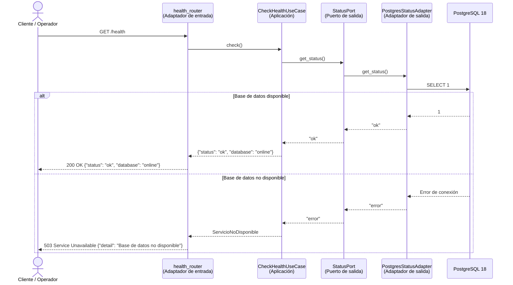
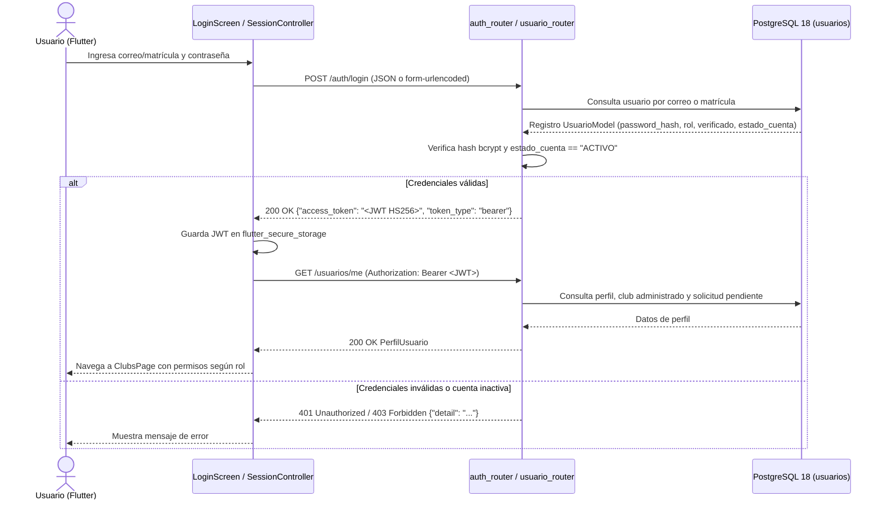
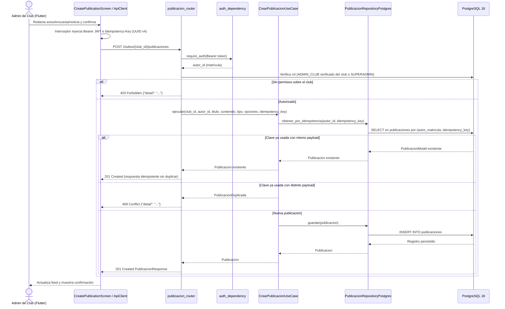
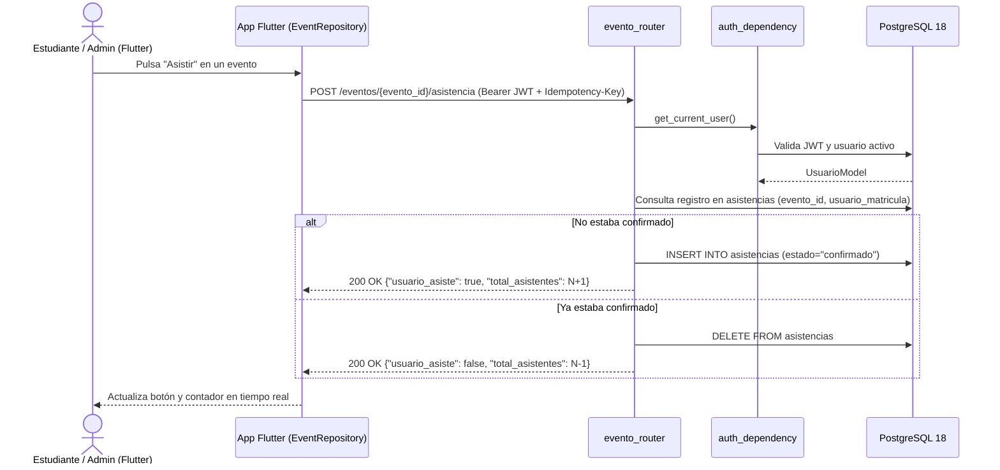

# 6. Vista de ejecución

Esta sección documenta, mediante diagramas de secuencia, cómo se comporta **LinkClub** en tiempo de ejecución en sus recorridos principales implementados de extremo a extremo: comprobación de salud, autenticación y carga de sesión, creación idempotente de publicaciones y gestión de eventos/asistencia.

## 6.1. Escenario: consulta de estado (`GET /health`)

## 6.2. Escenario: inicio de sesión y resolución de rol (`POST /auth/login` + `GET /usuarios/me`)

## 6.3. Escenario: creación idempotente de una publicación (`POST /clubes/{club_id}/publicaciones`)

## 6.4. Escenario: programación de evento y confirmación de asistencia (`POST /eventos` y `POST /eventos/{evento_id}/asistencia`)

