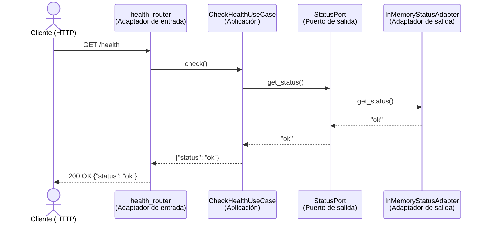
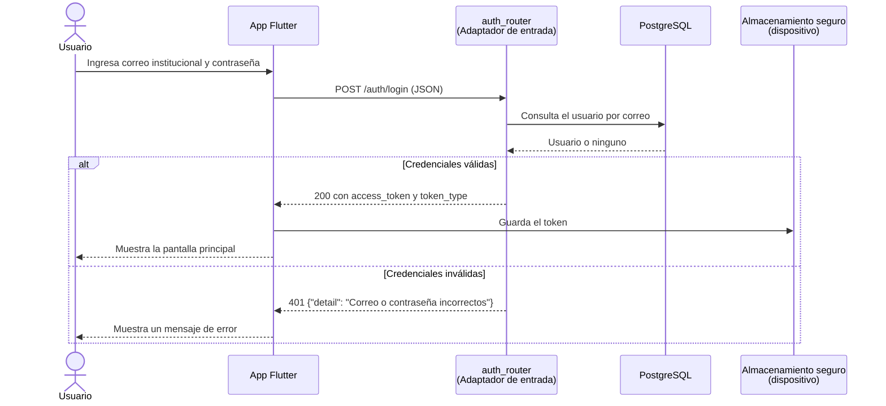
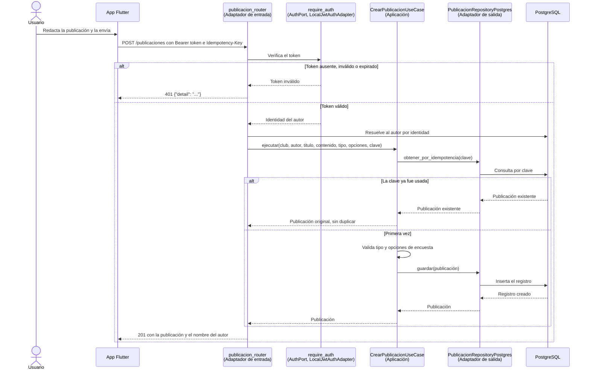

# 6. Vista de ejecución

Esta sección documenta, mediante diagramas de secuencia, cómo se comporta **LinkClub** en tiempo de ejecución en los tres recorridos que hoy están implementados de extremo a extremo: consulta de estado, inicio de sesión y creación de una publicación.

## 6.1. Escenario: consulta de estado (`GET /health`)

1. El cliente envía `GET /health` a la API.
2. El adaptador de entrada (`health_router.py`) delega en el caso de uso, sin lógica de negocio propia.
3. `CheckHealthUseCase` llama a `get_status()` sobre el puerto `StatusPort`; solo conoce la interfaz.
4. `InMemoryStatusAdapter` devuelve un valor fijo `"ok"` sin sondear la base de datos. Es un adaptador temporal.
5. La respuesta vuelve por las mismas capas con `200 OK`.

Cubierto por [`backend/tests/test_health.py`](../../backend/tests/test_health.py).

## 6.2. Escenario: inicio de sesión (`POST /auth/login`)

1. La app valida en el formulario que el correo termine en `@utb.edu.co`.
2. La API busca al usuario y, si las credenciales son correctas, emite un token JWT firmado con vigencia configurable (por defecto 7 días) cuyo sujeto es la matrícula.
3. La app guarda el token en almacenamiento seguro; un interceptor lo agrega como cabecera `Authorization: Bearer` en las peticiones siguientes, excepto las de `/auth/`.
4. Ante un `401`, la app informa que las credenciales son incorrectas.

Este recorrido aún no pasa por un caso de uso ni un puerto; es una desviación declarada (ver [diagrama de componentes](../c4/contexto.md)).

## 6.3. Escenario: creación de una publicación (`POST /publicaciones`)

1. Si la publicación incluye una imagen local, la app la sube antes con `POST /recursos/upload` y usa la URL devuelta como `imagen_url`.
2. El interceptor de la app agrega una `Idempotency-Key` (UUID v4) a cada `POST`. Ante un timeout, el reintento reutiliza la misma petición y el caso de uso devuelve la publicación ya creada en lugar de duplicarla (ver [`docs/resilience/idempotencia.md`](../resilience/idempotencia.md)).
3. La identidad del autor se toma siempre del token, nunca del cuerpo de la petición.
4. Un tipo de publicación no soportado o una encuesta sin opciones producen `422` con el formato uniforme `{"detail": "..."}`.

Cubierto por `backend/tests/test_publicaciones.py`, `test_auth.py` y `test_contrato_openapi.py`.

## 6.4. Relación con los escenarios de calidad

- **U2 (Disponibilidad):** hoy `/health` no depende de la base de datos, por lo que no detecta su caída. El manejo de errores de conexión (tiempo de espera, respuesta controlada) debe implementarse en los adaptadores de salida sin tocar casos de uso ni adaptadores de entrada. La decisión queda anotada en la [Sección 9](./09_decisiones_de_diseno.md#decisiones-pendientes-de-registrar).
- **U3 (Seguridad):** el recorrido 6.3 muestra el rechazo con `401` antes de llegar al caso de uso.
- **Resiliencia:** el recorrido 6.3 es el que ejerce la idempotencia definida en la [Sección 8](./08_conceptos_transversales.md) y en el [ADR 0008](../adr/0008-no-extraer-publicaciones.md).