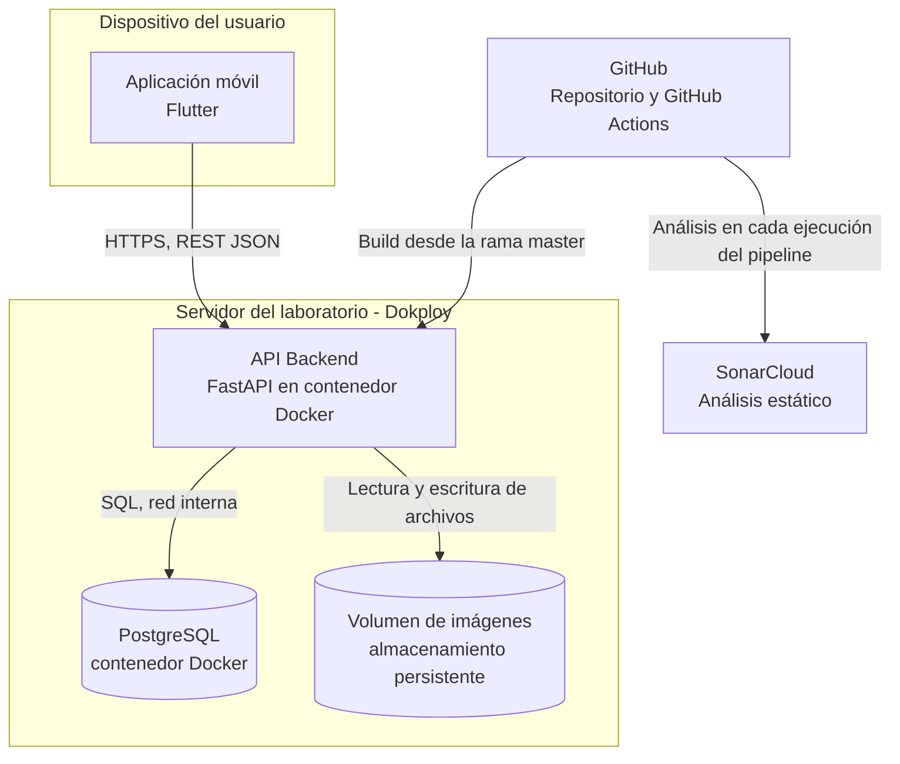

# 7. Vista de Despliegue

LinkClub opera con costo mensual cero: el backend y la base de datos se ejecutan como contenedores en el servidor del laboratorio de la universidad, administrado con Dokploy, y la integración continua usa GitHub Actions sobre un repositorio público. Todas las piezas son portables porque se basan en contenedores y tecnologías estándar (FastAPI, PostgreSQL, Docker). La decisión de abandonar Supabase como proveedor se registra en el [ADR 0007](../adr/0007-migracion-dokploy-postgresql.md), que reemplaza al [ADR 0004](../adr/0004-despliegue-base-de-datos.md) en lo relativo a persistencia y despliegue.

## 7.1. Nivel de Infraestructura 1 (Contexto Global de Despliegue)

| Pieza del Sistema | Entorno de Despliegue | Justificación | Costo Estimado |
|---|---|---|---|
| **Aplicación móvil (Frontend)** | Dispositivo móvil del usuario | Ejecución local en el cliente; interactúa con la API vía HTTPS. | $0 |
| **API Backend (FastAPI)** | Contenedor Docker en Dokploy, servidor del laboratorio | Ejecuta la lógica de negocio y la autenticación; sin arranque en frío ni límites de capa gratuita de terceros. Dominio público con HTTPS: `api-linkclub.iscoutb.dev`. | $0 |
| **Base de datos** | Contenedor PostgreSQL en Dokploy, misma red interna que la API | Latencia de red interna mínima y control total del esquema. No forma parte de la superficie pública de la API. | $0 |
| **Archivos subidos (imágenes)** | Volumen Docker persistente asociado al contenedor de la API | Los archivos sobreviven a los redespliegues; el disco del contenedor es efímero. | $0 |
| **Pipeline CI/CD** | GitHub Actions y SonarCloud | Ejecuta pruebas, validación del contrato OpenAPI y análisis estático. | $0 |

## 7.2. Nivel de Infraestructura 2 (Detalle de Piezas)

### 7.2.1. API Backend

* **Construcción:** Dokploy toma el repositorio, rama `master`, y construye la imagen con el `Dockerfile` de la carpeta `backend`. La imagen se ejecuta con un usuario sin privilegios.
* **Exposición:** el servicio publica el puerto 8000 detrás del dominio HTTPS configurado en Dokploy, con certificado Let's Encrypt. El TLS se termina en el proxy de la plataforma.
* **Configuración:** las variables `DATABASE_URL`, `JWT_SECRET` y `CORS_ORIGINS` se definen en el panel de Dokploy y nunca se versionan en el repositorio.
* **Recursos:** una réplica con límite de 1 GB de memoria y 2 CPU.

### 7.2.2. Base de datos (PostgreSQL)

* **Supuestos de uso (tráfico mensual UTB):** base activa de 2.000 estudiantes. Con 2 visitas semanales y 10 operaciones por visita se estiman 160.000 consultas SQL al mes. El almacenamiento primario (texto y UUIDs) se estima en unos 50 MB mensuales.
* **Costo y punto de quiebre:** el servidor es de la universidad, por lo que el costo es cero y no existen cuotas de terceros que se agoten. El límite pasa a ser el recurso asignado al contenedor (1 GB de memoria, 2 CPU) y el disco del servidor; si el crecimiento los supera, habría que solicitar más recursos al laboratorio.
* **Persistencia:** los datos residen en un volumen Docker dedicado; el esquema se crea a partir de [`backend/migrations/001_esquema_inicial.sql`](../../backend/migrations/001_esquema_inicial.sql).
* **Acceso:** la API se conecta por la red interna de Dokploy. La base de datos no debe quedar expuesta a Internet.
* **Respaldo:** no hay respaldo automático. Se debe ejecutar `pg_dump` de forma manual y periódica; está registrado como riesgo en la [Sección 11](./11_riesgos_y_deuda_tecnica.md).

### 7.2.3. Almacenamiento de imágenes

Las imágenes subidas por los usuarios se guardan en un volumen Docker montado en el contenedor de la API y se sirven bajo la ruta `/static`. La estrategia de persistencia multimedia y su evolución se