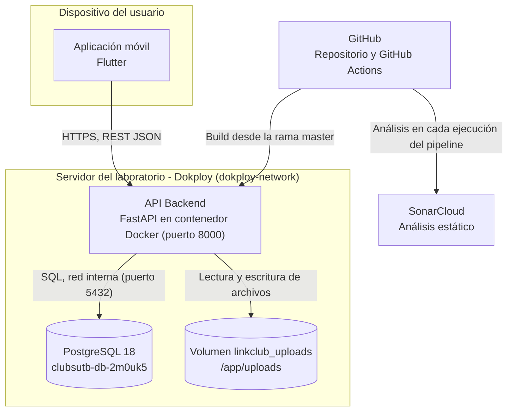

# 7. Vista de Despliegue

LinkClub opera con costo mensual cero: el backend y la base de datos se ejecutan como contenedores en el servidor del laboratorio de la universidad, administrado con Dokploy (`panel.iscoutb.dev`, proyecto `clubsutb`, entorno `production`), y la integración continua usa GitHub Actions sobre un repositorio público. Todas las piezas son portables porque se basan en contenedores y tecnologías estándar (FastAPI, PostgreSQL, Docker). La decisión de abandonar Supabase como proveedor se registra en el [ADR 0007](../adr/0007-migracion-dokploy-postgresql.md), que reemplaza al [ADR 0004](../adr/0004-despliegue-base-de-datos.md) en lo relativo a persistencia y despliegue.

## 7.1. Nivel de Infraestructura 1 (Contexto Global de Despliegue)

| Pieza del Sistema | Entorno de Despliegue | Justificación | Costo Estimado |
| ------ | ------ | ------ | ------ |
| **Aplicación móvil (Frontend)** | Dispositivo móvil del usuario (Android / iOS / escritorio) | Ejecución local en el cliente Flutter; interactúa con la API vía HTTPS y abre formularios externos (`Microsoft Forms`) en el navegador. | $0 |
| **API Backend (FastAPI)** | Contenedor Docker en Dokploy, servidor del laboratorio | Ejecuta la lógica de negocio, autenticación JWT y RBAC; sin arranque en frío ni límites de capa gratuita de terceros. Dominio público con HTTPS: `https://api-linkclub.iscoutb.dev`. | $0 |
| **Base de datos** | Contenedor PostgreSQL 18 en Dokploy, misma red interna (`dokploy-network`) | Latencia de red interna mínima y control total del esquema. No forma parte de la superficie pública de Internet. | $0 |
| **Archivos subidos (imágenes)** | Volumen Docker persistente (`linkclub_uploads`) asociado al contenedor de la API | Los archivos sobreviven a los redespliegues; el disco del contenedor es efímero ([ADR 0009](../adr/0009-estrategia-persistencia-multimedia.md)). | $0 |
| **Pipeline CI/CD** | GitHub Actions y SonarCloud | Ejecuta 38 pruebas automatizadas (`pytest`), validación del contrato OpenAPI (`Spectral` + `oasdiff`) y análisis estático. | $0 |

## 7.2. Nivel de Infraestructura 2 (Detalle de Piezas)

### 7.2.1. API Backend
* **Construcción:** Dokploy toma el repositorio `ISCOUTB/AS_202620_Clubs_UTB`, rama `master`, y construye la imagen con el `Dockerfile` de la carpeta `backend` (`python:3.12-slim`). La imagen se ejecuta con el usuario sin privilegios `appuser` (UID `1000`).
* **Exposición:** El servicio publica el puerto interno `8000` detrás del dominio HTTPS `api-linkclub.iscoutb.dev` configurado en Dokploy, con certificado Let's Encrypt automático. El TLS termina en el proxy inverso de la plataforma.
* **Configuración:** Las variables `DATABASE_URL`, `JWT_SECRET`, `JWT_EXPIRES_DAYS`, `CORS_ORIGINS` y `UPLOAD_DIR` se definen en el panel de Dokploy y nunca se versionan en el repositorio (plantilla en `backend/.env.example`).
* **Recursos:** Una réplica con límite de 1 GB de memoria y 2 CPU.

### 7.2.2. Base de datos (PostgreSQL 18)
* **Instancia:** Servicio `database` (`clubsutb-db-2m0uk5`) ejecutando `postgres:18` dentro de la red privada `dokploy-network`, puerto `5432` sin exposición pública.
* **Esquema y arranque:** El esquema base y la sincronización ORM están versionados en `backend/migrations/001_esquema_inicial.sql` y `backend/migrations/002_sincronizar_esquema_orm.sql`. Al iniciar, `main.py` ejecuta `Base.metadata.create_all(bind=engine)` e inserta de forma idempotente los 5 clubes semilla (`_SEMILLA`).
* **Nota de configuración:** El archivo `deploy/compose.lab.yaml` declara `postgres:16-alpine` como referencia local, mientras que el entorno activo en Dokploy ejecuta `postgres:18`.

### 7.2.3. Almacenamiento multimedia
* **Persistencia:** Volumen Docker `linkclub_uploads` montado en `/app/uploads` (`UPLOAD_DIR=/app/uploads`).
* **Acceso:** `recurso_router.py` valida extensiones (`jpg`, `jpeg`, `png`, `webp`, `gif`) y tamaño máximo (5 MB), guarda el archivo con nombre UUIDv4 y `main.py` lo expone en `/static/{archivo}`.

### 7.2.4. Pipeline CI/CD y calidad
* **Pruebas y contrato:** `.github/workflows/backend-tests.yml` ejecuta `pytest` (38 pruebas) y `.github/workflows/contrato.yml` valida `docs/api/openapi.yaml` con `Spectral` y verifica compatibilidad con `oasdiff`.
* **Análisis estático:** SonarCloud analiza el código fuente excluyendo pruebas y migraciones según `sonar-project.properties`.