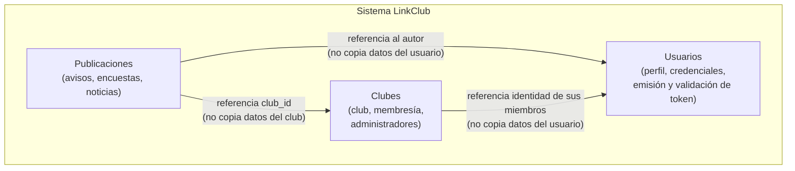

# 8. Conceptos transversales

Esta sección reúne los conceptos que atraviesan varios módulos de **LinkClub** y que, por eso mismo, deben tener un significado único y consistente en todo el sistema: el lenguaje ubicuo, los contextos delimitados, la estrategia de consistencia, la estrategia de caché, la idempotencia, la seguridad y la observabilidad.

## 8.1. Lenguaje ubicuo

El lenguaje ubicuo se organiza por contexto delimitado (ver 8.2), porque algunos términos cambian de significado o de nivel de detalle según el contexto que los usa. Cuando un término es ambiguo entre contextos, se aclara en la columna "Notas".

### Contexto Usuarios

| Término | Definición | Notas |
|---|---|---|
| Usuario | Persona registrada en LinkClub, dueña de un perfil (nombre, matrícula, correo, rol) y de sus credenciales. | Es el único contexto que almacena el perfil completo; los demás lo referencian por identidad. |
| Rol | Nivel de permisos de un usuario dentro del sistema (hoy `estudiante`). | No debe confundirse con "Administrador de club": el rol es un atributo del usuario, no una relación de membresía. |
| Identidad | Referencia mínima a un usuario que otros contextos usan para apuntar a él sin copiar su perfil. | Hoy es la matrícula, el mismo valor que viaja como sujeto del token. |
| Sesión / Token | Credencial JWT emitida por la propia API tras validar el correo y la contraseña. | Su formato está aislado detrás del puerto `AuthPort`; los demás contextos solo conocen la identidad que ese puerto devuelve. |

### Contexto Clubes

| Término | Definición | Notas |
|---|---|---|
| Club | Agrupación estudiantil con nombre, categoría y descripción. | Dueño único de estos datos: el contexto Clubes (ver [`tabla_modulo.md`](./tabla_modulo.md)). |
| Miembro | Usuario vinculado a un club como parte de su comunidad. | Clubes almacena la relación de membresía, no el perfil del miembro. |
| Administrador de club | Miembro con permiso para gestionar el club. | Es un rol dentro de la membresía de un club específico, distinto del rol global de Usuarios. |

### Contexto Publicaciones

| Término | Definición | Notas |
|---|---|---|
| Publicación | Elemento de comunicación emitido en nombre de un club. | Concepto raíz de este contexto; toda escritura pasa por aquí (`crear_publicacion.py`). |
| Tipo de publicación | Aviso, encuesta o noticia, resueltos con una sola entidad. | El evento se modela como recurso propio en el contrato y en el esquema (tabla `eventos`), aún sin implementar en la API. |
| Autor | Referencia a la identidad del usuario que originó la publicación. | Publicaciones no guarda el perfil del autor; el nombre mostrado en el feed se resuelve consultando a Usuarios. |
| Idempotency-Key | Cabecera con un UUID v4 que identifica un intento de creación. | Debe permitir que un reintento no duplique la publicación (ver 8.6). |

## 8.2. Mapa de contextos delimitados

LinkClub se divide en tres contextos internos y no tiene contextos externos en ejecución desde el [ADR 0007](../adr/0007-migracion-dokploy-postgresql.md). El detalle de cada frontera está en [`mapa-contextos-fundamentacion.md`](./mapa-contextos-fundamentacion.md).

| Contexto | Relación con los demás | Tipo de relación (DDD) |
|---|---|---|
| Usuarios | Es referenciado por Clubes y Publicaciones | Núcleo compartido: la identidad se comparte como referencia, no como copia |
| Clubes | Referencia a Usuarios; es referenciado por Publicaciones | Cliente de Usuarios y proveedor de Publicaciones |
| Publicaciones | Referencia a Clubes y a Usuarios | Cliente-proveedor: consume, no escribe en los otros dos |

**Regla que atraviesa los tres contextos:** ningún contexto copia datos que no le pertenecen; solo guarda la referencia (ID) al dueño real del dato. Es la regla que sostiene la tabla de propiedad de datos y el criterio con el que se detectaron las no conformidades de [`lista_errores.md`](./lista_errores.md). La fila de [`aspectos.md`](../aspectos.md) que corresponde a cada contexto está indicada en su sección "Aspectos por contexto".

## 8.3. Alineación con la tabla de módulos

El desajuste entre los cuatro módulos del primer corte y los tres contextos vigentes quedó resuelto con el [ADR 0002](../adr/0002-ajuste-contextos-publicaciones.md): Actividades y Notificaciones se fusionaron en Publicaciones, y [`tabla_modulo.md`](./tabla_modulo.md) usa los tres contextos como única fuente de verdad.

## 8.4. Estrategia de consistencia

PostgreSQL es el único almacén de datos de negocio y cada escritura se resuelve en una transacción local de una sola base ([ADR 0008](../adr/0008-no-extraer-publicaciones.md)), con el nivel de aislamiento por defecto de PostgreSQL (READ COMMITTED), que el código no modifica. Por eso la garantía por defecto es consistencia fuerte; la consistencia eventual aparece solo donde se introduce una copia (caché) o un proceso asíncrono (notificaciones). Los riesgos por operación están en [`tabla_garantia_consistencia.md`](./tabla_garantia_consistencia.md).

| Operación | Garantía | Mecanismo | Estado |
|---|---|---|---|
| Registro de usuario | Fuerte | Llave primaria en matrícula y unicidad de correo en la base | Implementada. El correo repetido responde 409; la matrícula repetida responde 500 (NC-13) |
| Inicio de sesión | Fuerte en la lectura; token sin estado | Consulta a la base y token con vencimiento; sin revocación en el servidor | Implementada |
| Crear publicación | Escritura atómica; efecto único previsto con `Idempotency-Key` | Un INSERT con un único `commit` por solicitud y columna `idempotency_key` única | Atómica e implementada. La respuesta del reintento no es consistente (ver 8.4.1) |
| Listar publicaciones y clubes | Fuerte hoy | Consulta directa sin caché; las publicaciones se leen sin paginación | Implementada |
| Subir imagen y publicar | Sin atomicidad entre archivo y registro | La imagen se sube antes; si la publicación falla, queda un archivo huérfano aceptado como costo ([ADR 0009](../adr/0009-estrategia-persistencia-multimedia.md)) | Implementada |
| Inscripción, eventos y asistencia | Fuerte | Restricciones únicas `(club_id, usuario_id)` y `(evento_id, usuario_id)` ya definidas en la migración | Sin implementar en la API |
| Notificar publicación creada | Eventual, al menos una vez | Outbox, reintentos con retroceso, DLQ y consumidor idempotente por `message_id` ([ADR 0009 de mensajería](../adr/0009-mensajeria-asincrona-notificaciones.md)) | Prototipo en memoria, verificado solo por pruebas |

### 8.4.1. Contraste de dos operaciones: crear y listar publicaciones

| Aspecto | Crear publicación (`POST /publicaciones`) | Listar publicaciones (`GET /publicaciones`) |
|---|---|---|
| Tipo | Escritura | Lectura pública |
| Almacén | Tabla `publicaciones` de PostgreSQL, mediante `PublicacionRepositoryPostgres` | La misma tabla, consultada desde el router con la sesión |
| Transacción | Un INSERT y un `commit`; si falla, la sesión se cierra sin confirmar | Una consulta de solo lectura |
| Garantía observada | Fuerte: tras el 201, la publicación es visible para cualquier lectura posterior | Lee solo datos confirmados; sin caché, lo ve inmediatamente (lectura de lo propio) |
| Concurrencia | Dos solicitudes simultáneas con la misma clave pueden pasar la consulta previa; la restricción única impide el segundo registro, pero el perdedor responde con un error genérico | No bloquea escrituras |
| Defecto verificado | Un reintento con la misma `Idempotency-Key` no duplica datos, pero responde 422 en lugar de devolver la publicación original (el identificador reconstruido es un UUID y la respuesta exige un entero). La clave es única de forma global, no por autor, y la consulta no compara autor ni contenido (NC-10) | Devuelve todos los registros sin paginar, lo que no escala con el volumen del escenario C2 (NC-23) |

La garantía real, por tanto, es consistencia fuerte sin caché y sin broker; ninguna garantía de entrega asíncrona se exige al flujo de publicaciones porque la notificación no está conectada a él.

## 8.5. Estrategia de caché y política de invalidación

**Decisión vigente: no se implementa caché.** El sistema tiene una réplica, una base en la misma red interna y un volumen estimado de 160.000 consultas mensuales; la latencia del escenario U1 aún no se ha medido. La caché se activa solo si esa medición (Evidencia S14) supera el umbral de 800 ms. El diseño queda definido para ese caso:

| Aspecto | Diseño |
|---|---|
| Alcance | Lecturas públicas: feed general, publicaciones por club, catálogo de clubes y detalle de club. No se cachean escrituras ni respuestas que dependan del usuario. |
| Ubicación | Memoria del proceso de la API (una réplica). No se incorpora Redis por las restricciones C2 y F1; por eso no aparece un contenedor de caché en el [C4 nivel 2](../c4/contexto.md). |
| Clave | Ruta y parámetros de consulta normalizados. |
| Expiración | TTL de 300 segundos. |
| Invalidación por evento | Una publicación creada elimina las entradas del feed general y del club afectado; la creación de un club elimina las del catálogo. |
| Garantía resultante | Lectura de lo propio inmediata en la misma réplica; desfase máximo de 300 segundos ante cambios que no pasen por la API. |
| Límites | Un reinicio vacía la caché. Con más de una réplica la invalidación local deja de bastar y habría que compartirla o retirar la caché. |

## 8.6. Idempotencia y reintentos

El cliente móvil agrega una `Idempotency-Key` (UUID v4) a toda petición `POST` mediante un interceptor. El caso de uso consulta la clave antes de crear y la base impone unicidad sobre ella. El diseño completo está en [`docs/resilience/idempotencia.md`](../resilience/idempotencia.md). Los mensajes asíncronos siguen la misma lógica con `message_id` como clave de deduplicación.

Desviaciones abiertas, registradas en [`lista_errores.md`](./lista_errores.md) (NC-10): el reintento responde con error en lugar de la publicación original, la clave no está aislada por autor y el código de estado difiere entre el código (siempre 201), el contrato (409) y el documento de diseño (200).

## 8.7. Autenticación, autorización y errores

* **Autenticación:** la API emite tokens JWT firmados con HS256, con el sujeto igual a la matrícula y vigencia configurable (7 días por defecto). Las lecturas son públicas y toda escritura, salvo registro e inicio de sesión, exige un token válido mediante la dependencia `require_auth` (escenario U3), incluida la carga de imágenes.
* **Identidad del autor:** siempre se toma del token, nunca del cuerpo de la petición.
* **Autorización por rol dentro de cada club:** sin implementar; depende de las membresías.
* **Formato de error uniforme:** `{"detail": "mensaje"}` en 401, 403, 404, 409 y 422. Hoy algunas respuestas 422 incluyen texto interno de excepciones (NC-21).
* **Contraseñas y secreto de firma:** la contraseña se almacena y compara sin hash, y el secreto JWT tiene un valor por defecto en el código si la variable no está definida. Ambos son riesgos prioritarios de la [Sección 11](./11_riesgos_y_deuda_tecnica.md).

## 8.8. Observabilidad

* **Mensajería:** cada etapa deja un registro con `message_id` y `correlation_id`, y existen contadores en memoria (`application/messaging/observabilidad.py`). Es un prototipo sin conexión a la API.
* **API:** no hay registros estructurados ni métricas expuestas. La dependencia `prometheus-fastapi-instrumentator` está declarada pero no se usa (NC-16).
* **Estado del servicio:** `/health` es una comprobación de vida (liveness): confirma que la API responde, no que la base de datos esté disponible. Una comprobación de disponibilidad de la base está registrada como NC-09.
