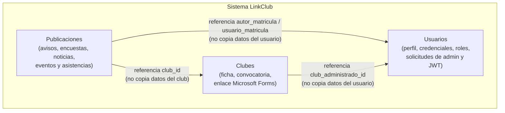

# 8. Conceptos transversales

Esta sección reúne los conceptos que atraviesan varios módulos de **LinkClub** y que, por eso mismo, deben tener un significado único y consistente en todo el sistema: el lenguaje ubicuo, los contextos delimitados, la estrategia de consistencia, la estrategia de caché, la idempotencia, la seguridad y la observabilidad.

## 8.1. Lenguaje ubicuo

El lenguaje ubicuo se organiza por contexto delimitado (ver 8.2), porque algunos términos cambian de significado o de nivel de detalle según el contexto que los usa.

| Término | Contexto | Significado en el sistema | Notas / Distinción |
| ------ | ------ | ------ | ------ |
| **Usuario / Matrícula** | Usuarios | Persona registrada con correo `@utb.edu.co` y matrícula (`^T[0-9]{7,8}$`). La matrícula es el identificador único (`sub` del JWT). | No se duplica el nombre ni el correo en otros contextos; se referencia por `autor_matricula` o `usuario_matricula`. |
| **Rol (`ESTUDIANTE`, `ADMIN_CLUB`, `SUPERADMIN`)** | Usuarios | Nivel de privilegio asignado al usuario. Un `ADMIN_CLUB` requiere `verificado = true` y un `club_administrado_id` asignado. | Un solicitante de `ADMIN_CLUB` nace con `verificado = false` hasta que un `SUPERADMIN` aprueba su solicitud. |
| **Solicitud de Admin** | Usuarios | Petición registrada en `solicitudes_admin_club` (`PENDIENTE`, `APROBADA`, `RECHAZADA`) vinculando un usuario con un club. | Gobernanza exclusiva de `SUPERADMIN` (`/admin/solicitudes`). |
| **Club** | Clubes | Organización estudiantil oficial de la UTB con ficha pública (nombre, categoría, descripción, líder, horario, lugar, redes). | Persistido en PostgreSQL (`clubes`). |
| **Inscripción externa (`ms_forms_url`)** | Clubes | Enlace a un formulario institucional externo (Microsoft Forms) controlado por `inscripciones_abiertas` y `aviso_inscripcion`. | LinkClub no gestiona listas internas de miembros vía API; delega el registro formal al formulario institucional. |
| **Publicación** | Publicaciones | Contenido emitido en nombre de un club (`aviso`, `encuesta` con opciones, o `noticia`) con imagen opcional. | Pertenece a un `club_id` y a un `autor_matricula`. |
| **Evento y Asistencia** | Publicaciones | Actividad programada por un club (`PUBLICO` o `SOLO_CLUB`) a la cual los usuarios pueden confirmar asistencia (`asistencias`). | Referencia `club_id` y `autor_matricula` sin copiar metadatos del club ni del usuario. |

## 8.2. Mapa de contextos delimitados

LinkClub se divide en tres contextos internos y no tiene contextos externos de datos ni de identidad en ejecución desde el [ADR 0007](../adr/0007-migracion-dokploy-postgresql.md). El detalle de cada frontera está en [mapa-contextos-fundamentacion.md](./mapa-contextos-fundamentacion.md).

| Contexto | Relación con los demás | Tipo de relación (DDD) |
| ------ | ------ | ------ |
| **Usuarios** | Es referenciado por Clubes y Publicaciones | Núcleo compartido: la identidad (`matricula`) y el vínculo de administración se comparten como referencia, no como copia. |
| **Clubes** | Referencia a Usuarios (administradores verificados); es referenciado por Publicaciones | Cliente de Usuarios y proveedor de Publicaciones. |
| **Publicaciones** | Referencia a Clubes y a Usuarios | Cliente-proveedor: consume referencias (`club_id`, `matricula`), no modifica los otros dos contextos. |

**Regla que atraviesa los tres contextos:** ningún contexto copia datos que no le pertenecen; solo guarda la referencia (ID / matrícula) al dueño real del dato. Es la regla que sostiene [tabla_modulo.md](./tabla_modulo.md) y el criterio con el que se auditan las no conformidades de [lista_errores.md](./lista_errores.md).

## 8.3. Alineación con la tabla de módulos

La discrepancia inicial entre los cuatro módulos del corte 1 y los tres contextos delimitados del [ADR 0002](../adr/0002-ajuste-contextos-publicaciones.md) quedó resuelta en [tabla_modulo.md](./tabla_modulo.md), unificando Actividades (incluidos eventos) y Notificaciones dentro del contexto **Publicaciones**.

## 8.4. Estrategia de consistencia

* **Consistencia fuerte en PostgreSQL:** Todas las entidades persistentes (`usuarios`, `clubes`, `publicaciones`, `eventos`, `asistencias` y `solicitudes_admin_club`) operan bajo transacciones ACID en la misma base de datos PostgreSQL 18 (`linkclub`).
* **Integridad referencial y unicidad:** El esquema impone llaves foráneas (`ON DELETE CASCADE` / `SET NULL`), unicidad de correo (insensible a mayúsculas) y matrícula en `usuarios`, unicidad de nombre en `clubes`, unicidad compuesta `(autor_matricula, idempotency_key)` en `publicaciones` y unicidad `(evento_id, usuario_matricula)` en `asistencias`.
* **Consistencia eventual (prototipo de mensajería):** El módulo experimental `application/messaging/` y `adapters/outbound/messaging/` implementa el patrón *Outbox* con entrega al-menos-una-vez y deduplicación por `message_id` ([ADR 0010](../adr/0010-mensajeria-asincrona-notificaciones.md)), verificado por pruebas automatizadas sin broker externo desplegado.

## 8.5. Estrategia de caché

**Decisión vigente: no se implementa caché** ni en el servidor (sin Redis ni caché en memoria) ni caché persistente local en el cliente móvil. Dado el volumen institucional de clubes y publicaciones en la UTB y la comunicación directa entre contenedores dentro de `dokploy-network`, las consultas indexadas en PostgreSQL cumplen con holgura el umbral de latencia $\le 800\text{ ms}$ (escenario **U1**) sin introducir riesgos de datos obsoletos tras crear o editar clubes, eventos o publicaciones.

## 8.6. Idempotencia

Para evitar duplicaciones ante reintentos de red o dobles pulsaciones en dispositivos móviles (detalle completo en [docs/resilience/idempotencia.md](../resilience/idempotencia.md)):

1. **Cliente móvil (`ApiClient`):** Un interceptor de `Dio` genera e inyecta automáticamente una cabecera `Idempotency-Key` (UUID v4) en toda solicitud `POST` que no la incluya previamente.
2. **Backend (`CrearPublicacionUseCase` + `PublicacionRepositoryPostgres`):** Al recibir `POST /clubes/{club_id}/publicaciones`, verifica si `(autor_id, idempotency_key)` ya existe. Si existe con el mismo contenido, devuelve `201 Created` con el recurso original sin duplicar filas; si el contenido difiere, rechaza con `409 Conflict`; si la cabecera llega vacía, responde `422 Unprocessable Entity`.
3. **Asistencia a eventos (`POST /eventos/{evento_id}/asistencia`):** Opera como conmutador transaccional protegido por la restricción única `(evento_id, usuario_matricula)` en PostgreSQL.

## 8.7. Seguridad (Autenticación y Autorización)

* **Almacenamiento de credenciales:** Las contraseñas se procesan exclusivamente con hash adaptativo `bcrypt` en `auth_router.py` y `usuario_router.py`; nunca se almacenan ni registran en texto plano.
* **Tokens de sesión:** La API emite tokens JWT firmados con `HS256` (`JWT_SECRET` obligatorio con validación *fail-fast* al arrancar) y expiración configurable (`JWT_EXPIRES_DAYS=7` por defecto). El cliente Flutter los persiste cifrados mediante `flutter_secure_storage`.
* **Control de acceso basado en roles (RBAC):**
  * Lecturas públicas: `GET /health`, `GET /clubes`, `GET /clubes/{club_id}`, `GET /publicaciones`, `GET /clubes/{club_id}/publicaciones`, `GET /static/{archivo}` y `GET /eventos` (que acepta token opcional para incluir eventos `SOLO_CLUB` del club administrado).
  * Escrituras autenticadas (`401 Unauthorized` si falta token o es inválido): todas las rutas `POST`, `PATCH` y `DELETE` excepto `/auth/registro` y `/auth/login`.
  * Restricción por rol (`403 Forbidden`): crear publicaciones o eventos y editar un club exige `ADMIN_CLUB` con `verificado = true` y `club_administrado_id == club_id` (o `SUPERADMIN`); crear clubes y aprobar/rechazar solicitudes exige `SUPERADMIN`.

## 8.8. Observabilidad y trazabilidad

* **Registro de errores y eventos de API:** `main.py` centraliza los manejadores de excepciones (`RequestValidationError` -> `422` uniforme y `Exception` -> `500` con traza en logger `linkclub.api`) sin filtrar trazas internas ni credenciales al cliente.
* **Sondeo de disponibilidad:** `GET /health` ejecuta `SELECT 1` contra PostgreSQL mediante `PostgresStatusAdapter`, respondiendo `200 {"status": "ok", "database": "online"}` o `503 Service Unavailable` si la base no responde.
* **Trazabilidad de mensajes:** `application/messaging/observabilidad.py` registra eventos estructurados con `message_id`, `correlation_id` y contadores (`publicados`, `reintentos`, `procesados`, `duplicados_descartados`, `dlq`) conforme al [ADR 0010](../adr/0010-mensajeria-asincrona-notificaciones.md).