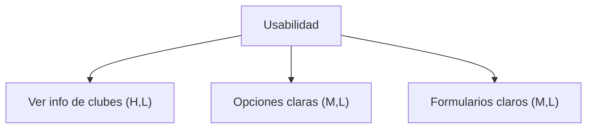
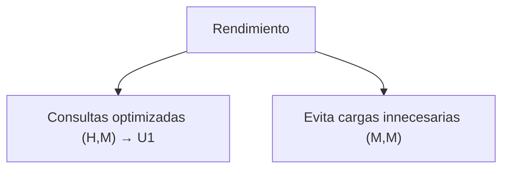
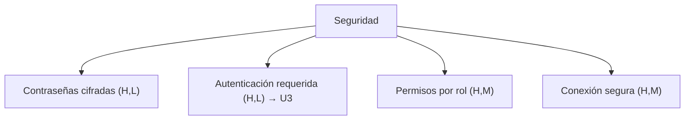
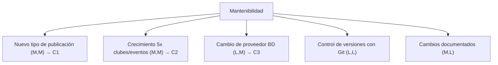
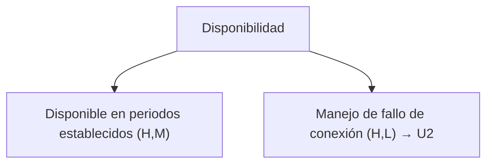

# 10. Requisitos de calidad

Los siguientes requisitos son las características que debe cumplir **LinkClub** para garantizar que sea fácil de utilizar, seguro y rápido.

## Usabilidad
* Los estudiantes deben poder ver la información de los clubes.
* Las opciones deben verse claramente.
* Los formularios son claros en los campos que pidan ingresar los datos.

## Rendimiento
* El sistema evita cargas innecesarias de información.
* Las consultas de la base de datos están optimizadas para evitar tiempos de respuesta muy extensos.

## Seguridad
* Las contraseñas no se almacenan en texto plano.
* Los usuarios deben autenticarse antes de acceder a las funcionalidades de escritura; las consultas son públicas según el contrato.
* Los permisos dependen del rol del usuario.
* La conexión entre el cliente y el servidor es segura (HTTPS) cuando el sistema está desplegado.

## Mantenibilidad
* Se utiliza el control de versiones mediante git.
* Los cambios serán documentados.
* El código está dividido en componentes según sus responsabilidades.

## Disponibilidad
* El sistema está disponible durante los periodos establecidos.
* En caso de falla, **LinkClub** muestra un mensaje indicando que el servicio no está disponible.

## 10.1. Árbol de Utilidades
> Cada hoja indica su prioridad como (Importancia, Dificultad), donde H = alta, M = media, L = baja.
> Por ejemplo (H, L) significa alta importancia para el negocio y baja dificultad técnica.
### Usabilidad

### Rendimiento

### Seguridad

### Mantenibilidad

### Disponibilidad

## 10.2. Escenarios de Calidad
### Escenarios de Uso
|num| Atributo de calidad | Fuente | Estimulo |Artefacto|Entorno|Respuesta| Medida|
|---|---|---|---|---|---|---|---|
|U1|Rendimiento|Usuario final (Estudiante o líder de club)|Envía una solicitud de búsqueda de eventos/clubes|Módulo de búsqueda|Operación normal, carga promedio|El sistema procesa y devuelve resultados|El diseño debe garantizar un presupuesto de latencia ≤800 ms en el camino crítico (red + FastAPI + consulta a PostgreSQL)|
|U2|Disponibilidad|Servicio de base de datos (PostgreSQL)|Se pierde la conexión con la base de datos|Backend FastAPI|Producción, hora pico (ej. publicación de nuevo evento)|El sistema detecta el fallo, evita que la app se caiga por completo, y muestra un mensaje de error controlado al usuario|El diseño debe contemplar manejo explícito de errores de conexión (try/catch + respuesta HTTP controlada) en el 100% de los endpoints que consultan la BD, sin excepciones no controladas|
|U3|Seguridad|Usuario no autorizado|Intenta acceder a un endpoint de escritura sin un token válido emitido por la API|Backend FastAPI (dependencia de autenticación)|Operación normal|El sistema rechaza la solicitud con 401 y registra el intento|El diseño debe validar el token en el 100% de los endpoints de escritura, excepto registro e inicio de sesión, mediante una dependencia de autenticación; verificable por revisión de código y por prueba automatizada|

### Escenarios de Cambio
|num| Atributo de calidad | Fuente | Estimulo |Artefacto|Entorno|Respuesta| Medida|
|---|---|---|---|---|---|---|---|
|C1|Modificabilidad|Desarrollador/equipo del proyecto|Solicita agregar un nuevo tipo de publicación, por ejemplo encuesta, para que los clubes consulten a sus miembros|Módulo de gestión de publicaciones/avisos|Tiempo de diseño/desarrollo (no en producción)|Se implementa el nuevo tipo de contenido reutilizando la estructura existente de publicaciones, sin modificar los módulos de autenticación, clubes o eventos|El cambio requiere modificar ≤ 3 módulos (modelo de datos, endpoint API, vista Flutter) y no afecta código de módulos no relacionados|
|C2|Escalabilidad|Administrador del sistema|El número de clubes, eventos y publicaciones crece 5 veces respecto al volumen estimado|Esquema de datos y API|Producción, tras el crecimiento|El sistema sigue operando con el mismo esquema, sin migraciones estructurales|El crecimiento se absorbe sin modificar las tablas existentes y los listados mantienen una latencia ≤800 ms mediante índices|
|C3|Portabilidad|Equipo técnico|Se decide reemplazar el proveedor o motor de base de datos o de autenticación|Adaptadores de persistencia y de autenticación|Tiempo de diseño, antes de producción|El sistema se despliega en el nuevo entorno|El cambio se limita a los adaptadores de salida; ≤ 2 módulos fuera de esa capa requieren modificación, verificable por revisión de la arquitectura hexagonal|

## 10.3. Estado de verificación

| Escenario | Estado | Evidencia o pendiente |
|---|---|---|
| U1 | Sin medir | La latencia del camino crítico aún no se ha medido (Evidencia S14). |
| U2 | Parcial | El cliente muestra mensajes controlados ante fallos de red. `/health` no sondea la base y falta un manejo centralizado de errores de conexión en la API. |
| U3 | Parcial | Dependencia `require_auth` en las rutas de publicación, verificada en `backend/tests/test_auth.py`. Falta cubrir todas las rutas de escritura que corresponden, ajustar la prueba automática de cobertura y registrar los intentos rechazados. |
| C1 | Verificado en parte | Los tipos aviso, encuesta y noticia se resuelven con una sola entidad y están cubiertos por `backend/tests/test_publicaciones.py`. |
| C2 | Sin medir | No se ha ejecutado una prueba con volumen incrementado (Evidencia S14). |
| C3 | Ejercido, sin medición formal | La migración del [ADR 0007](../adr/0007-migracion-dokploy-postgresql.md) reemplazó proveedor de datos y autenticación; falta documentar el recuento de módulos afectados. |
| Protección de contraseñas | Pendiente | Implementación de hash de contraseñas planificada. |
| Permisos por rol | Pendiente | Requiere implementar el contexto Clubes con membresías. |