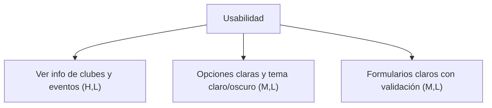
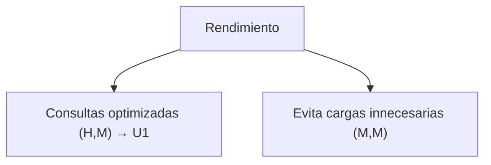
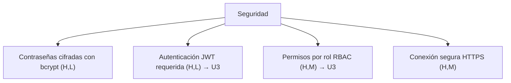
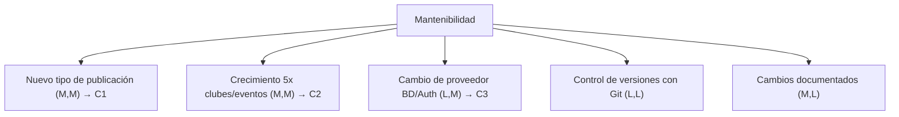

# 10. Requisitos de calidad

Los siguientes requisitos son las características que debe cumplir **LinkClub** para garantizar que sea confiable, seguro, rápido y mantenible.

## Mantenibilidad
* Se utiliza el control de versiones mediante Git (`ISCOUTB/AS_202620_Clubs_UTB`).
* Los cambios relevantes se documentan en `docs/arc42/`, `docs/api/CHANGELOG.md` y registros ADR.
* El código está dividido en componentes según sus responsabilidades (arquitectura hexagonal en el backend y separación por capas en Flutter).

## Disponibilidad
* El sistema opera en infraestructura autónoma (Dokploy + PostgreSQL 18) sin depender de capas gratuitas de terceros que se suspendan por inactividad.
* En caso de falla de la base de datos, **LinkClub** responde de forma controlada (`503 Service Unavailable`) y muestra mensajes claros en la interfaz móvil.

## 10.1. Árbol de Utilidades

Cada hoja indica su prioridad como `(Importancia, Dificultad)`, donde `H` = alta, `M` = media, `L` = baja. Por ejemplo `(H, L)` significa alta importancia para el negocio y baja dificultad técnica.

### Usabilidad

### Rendimiento

### Seguridad

### Mantenibilidad

## 10.2. Escenarios de Uso

| ID | Atributo de calidad | Fuente | Estímulo | Artefacto | Entorno | Respuesta | Medida |
| ------ | ------ | ------ | ------ | ------ | ------ | ------ | ------ |
| **U1** | Rendimiento | Estudiante / Usuario móvil | Consulta y filtra el catálogo de clubes (`GET /clubes`), el feed de publicaciones (`GET /publicaciones`) o la agenda de eventos (`GET /eventos`) | API Backend y PostgreSQL 18 | Producción (Dokploy, carga normal del campus) | El backend ejecuta la consulta filtrada sobre PostgreSQL y devuelve la respuesta JSON serializada | Latencia P95 $\le 800\text{ ms}$ en el 95 % de las solicitudes |
| **U2** | Disponibilidad | Operador / Cliente móvil | Se interrumpe la conexión con PostgreSQL o el servicio recibe un sondeo de salud (`GET /health`) | `health_router.py` y `PostgresStatusAdapter` | Producción, ante degradación de la base de datos | El sistema detecta la indisponibilidad mediante `SELECT 1` sin colapsar ni exponer trazas internas | 100 % de las peticiones reciben una respuesta HTTP controlada (`503` en `/health` o `500` uniforme `{"detail": "..."}`) |
| **U3** | Seguridad | Usuario no autenticado o sin privilegios | Intenta ejecutar una operación de escritura (`POST`, `PATCH`, `DELETE`) sin token válido o sobre un club que no administra | `auth_dependency.py` y routers protegidos | Producción | El sistema rechaza la petición antes de modificar datos en PostgreSQL | 100 % de las rutas de escritura protegidas exigen JWT (`401`) y validan rol (`403` si no es `ADMIN_CLUB` verificado o `SUPERADMIN`) |

## 10.3. Escenarios de Cambio

| ID | Atributo de calidad | Fuente | Estímulo | Artefacto | Entorno | Respuesta | Medida |
| ------ | ------ | ------ | ------ | ------ | ------ | ------ | ------ |
| **C1** | Modificabilidad | Desarrollador / equipo del proyecto | Solicita agregar un nuevo tipo de publicación (por ejemplo `encuesta` o `noticia`) para que los clubes informen o consulten a los estudiantes | Módulo de gestión de publicaciones | Tiempo de desarrollo | Se incorpora la nueva variante reutilizando la estructura de publicaciones, sin modificar autenticación ni clubes | El cambio requiere modificar $\le 3$ módulos (dominio/caso de uso, endpoint/contrato, vista Flutter) y no afecta módulos ajenos |
| **C2** | Escalabilidad | Administrador del sistema | El número de clubes, eventos y publicaciones crece 5 veces respecto al volumen inicial estimado | Esquema de datos PostgreSQL y API | Producción, tras el crecimiento | El sistema sigue operando con el mismo esquema relacional, sin migraciones estructurales | El crecimiento se absorbe sin modificar las tablas existentes y los listados mantienen latencia P95 $\le 800\text{ ms}$ |
| **C3** | Portabilidad | Equipo técnico | Se decide reemplazar el proveedor o motor de base de datos o de autenticación (como ocurrió al migrar de Supabase a Dokploy + PostgreSQL en el ADR 0007) | Adaptadores de persistencia y de autenticación | Tiempo de diseño / despliegue | El sistema se despliega sobre la nueva infraestructura | El cambio se limita a los adaptadores de salida; $\le 2$ módulos fuera de esa capa requieren modificación |