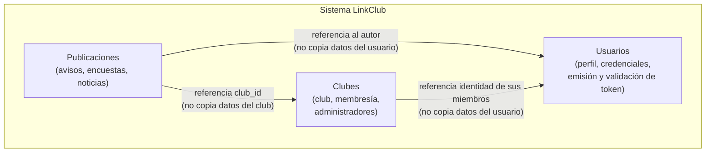

# Mapa de contextos - LinkClub

## Contextos identificados

LinkClub se organiza en tres contextos internos, subdominios del propio sistema delimitados por responsabilidad de negocio. Desde el [ADR 0007](../adr/0007-migracion-dokploy-postgresql.md) no existen contextos externos en ejecución: la autenticación y la persistencia son propias del sistema.

| Contexto | Tipo | Responsabilidad de negocio |
|---|---|---|
| **Clubes** | Interno | Gestiona la existencia de cada club y su membresía: quién pertenece a qué club, quién lo administra |
| **Publicaciones** | Interno | Gestiona avisos, encuestas y noticias publicados en nombre de un club |
| **Usuarios** | Interno | Gestiona la identidad, el perfil y las credenciales de cada persona dentro del sistema (nombre, matrícula, correo, rol) |

## Diagrama

## Relaciones entre contextos

**Clubes - Usuarios (referencia, no copia).** El contexto Clubes es dueño de la relación de membresía: cada club mantiene su propia lista de miembros. Esa lista no contiene copias de los datos personales de cada usuario, solo una referencia a su identidad (los datos completos del perfil viven únicamente en el contexto Usuarios).

**Publicaciones - Clubes (referencia).** Cada publicación pertenece a exactamente un club, identificado por `club_id`. Publicaciones no almacena ninguna información propia del club (nombre, descripción); solo la referencia.

**Publicaciones - Usuarios (referencia).** Cada publicación tiene un autor. Publicaciones guarda únicamente la identidad del autor, que hoy es la matrícula, el mismo valor que viaja como sujeto del token. El nombre que se muestra en el feed se resuelve consultando a Usuarios y no se almacena en la publicación.

## Autenticación como parte de Usuarios

Con la eliminación del proveedor externo, la emisión y validación de tokens pertenecen al contexto Usuarios. El formato del token sigue aislado detrás del puerto de salida `AuthPort` y de su adaptador `LocalJwtAuthAdapter`, de modo que Clubes y Publicaciones solo conocen la identidad que el puerto devuelve, nunca las reclamaciones del token. Esa separación conserva la protección que antes ofrecía la capa anticorrupción frente a un proveedor externo y permite cambiar de mecanismo sin tocar los demás contextos.

## Estado de implementación por contexto

| Contexto | Implementado | Pendiente |
|---|---|---|
| Usuarios | Registro, inicio de sesión, token y dependencia de seguridad | Perfil, hash de contraseñas, roles por membresía |
| Clubes | Consulta con filtros, datos en memoria | Persistencia, creación, membresías |
| Publicaciones | Creación y listado con persistencia e idempotencia | Autorización por club, eventos como subtipo |

## Notas

* Este diagrama modela únicamente conceptos de negocio y fronteras de control. Flutter y FastAPI son las tecnologías con las que se construye LinkClub: la interfaz y el backend son el sistema, no algo externo a él.
* La base de datos (PostgreSQL en contenedor propio) es un detalle de infraestructura interno a cada contexto: cada uno es responsable de persistir sus propios datos, sin que eso constituya un contexto ni un actor aparte.
* Decisión que fusiona los módulos originales en estos tres contextos: [ADR 0002](../adr/0002-ajuste-contextos-publicaciones.md). Propiedad de datos: [`tabla_modulo.md`](./tabla_modulo.md). Decisión de mantener un único backend: [ADR 0008](../adr/0008-no-extraer-publicaciones.md).