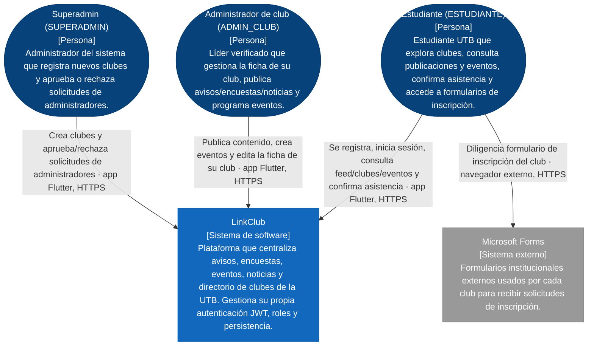
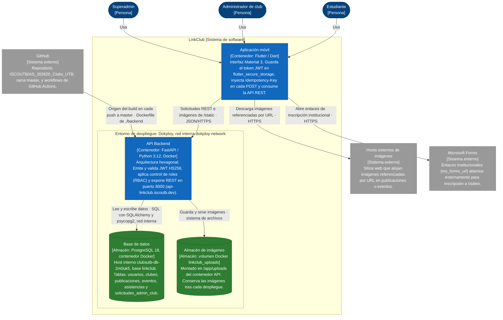

### C4 - Diagrama de Contexto
*  Tipo: C4 nivel 1 (Contexto del sistema)
*  Fecha de actualización: 2026-11-22
*  Alcance: LinkClub como una sola caja, sus usuarios y los sistemas externos con los que se comunica en ejecución.
*  Estado: vigente tras el ADR 0007. Supabase fue descartado; la autenticación, el control de roles y la persistencia son propios del sistema.

### C4 - Diagrama de Contenedores
*  Tipo: C4 nivel 2 (Contenedores)
*  Fecha de actualización: 2026-11-22
*  Alcance: unidades desplegables y almacenes de datos de LinkClub, y cómo se comunican.
*  Entorno de despliegue: Dokploy (panel.iscoutb.dev), proyecto `clubsutb`, entorno `production`. API pública en `[https://api-linkclub.iscoutb.dev](https://api-linkclub.iscoutb.dev)`.

### C4 - Diagrama de Componentes (API Backend)
*  Tipo: C4 nivel 3 (Componentes del contenedor API Backend)
*  Fecha de actualización: 2026-11-22
*  Alcance: componentes de `backend/src/linkclub` y sus dependencias, con el estado real de implementación.

```mermaid
graph TD
    classDef entrada fill:#1168BD,stroke:#105EAB,color:#fff;
    classDef app fill:#438DD5,stroke:#3878B4,color:#fff;
    classDef puerto fill:#6C8EBF,stroke:#4A6FA5,color:#fff;
    classDef dominio fill:#08427B,stroke:#073B6F,color:#fff;
    classDef salida fill:#438DD5,stroke:#3878B4,color:#fff;
    classDef temporal fill:#438DD5,stroke:#F57C00,color:#fff,stroke-dasharray:5 5;
    classDef almacen fill:#2E7D32,stroke:#1B5E20,color:#fff;
    classDef externo fill:#999999,stroke:#888888,color:#fff;

    APP_MOVIL["Aplicación móvil<br/>[Contenedor: Flutter]"]:::externo
    OPER["Operador o pipeline<br/>[Consumidor externo]<br/>Verifica el estado del servicio."]:::externo
    DB[("PostgreSQL 18<br/>[Almacén: base linkclub]")]:::almacen
    FS[("Volumen linkclub_uploads<br/>[Almacén: /app/uploads]")]:::almacen

    subgraph API["API Backend [Contenedor: FastAPI / Python 3.12]"]
        subgraph ENT["Adaptadores de entrada - adapters/inbound/api"]
            R_HEALTH["health_router<br/>[Componente: Adaptador de entrada]<br/>GET /health."]:::entrada
            R_AUTH["auth_router<br/>[Componente: Adaptador de entrada]<br/>POST /auth/registro y POST /auth/login (JSON y form). Hash bcrypt y JWT HS256."]:::entrada
            R_USR["usuario_router<br/>[Componente: Adaptador de entrada]<br/>GET/PATCH/DELETE /usuarios/me, cambio de contraseña y /admin/solicitudes."]:::entrada
            R_CLUB["club_router<br/>[Componente: Adaptador de entrada]<br/>GET /clubes (q, categoria), GET/PATCH /clubes/{club_id} y POST /clubes."]:::entrada
            R_PUB["publicacion_router<br/>[Componente: Adaptador de entrada]<br/>GET /publicaciones, GET y POST /clubes/{club_id}/publicaciones con Idempotency-Key."]:::entrada
            R_EVT["evento_router<br/>[Componente: Adaptador de entrada]<br/>GET y POST /eventos (PUBLICO/SOLO_CLUB) y POST /eventos/{evento_id}/asistencia."]:::entrada
            R_REC["recurso_router<br/>[Componente: Adaptador de entrada]<br/>POST /recursos/upload (máx. 5 MB). main.py monta /static."]:::entrada
            DEP_AUTH["auth_dependency<br/>[Componente: Dependencia de seguridad]<br/>require_auth, get_current_user y require_superadmin (401/403/503)."]:::entrada
        end

        subgraph APL["Aplicación - application"]
            UC_HEALTH["CheckHealthUseCase<br/>[Componente: Caso de uso]"]:::app
            UC_CLUB["ListarClubesUseCase y ObtenerClubUseCase<br/>[Componente: Caso de uso]"]:::app
            UC_PUB["CrearPublicacionUseCase<br/>[Componente: Caso de uso]<br/>Valida tipo, opciones de encuesta e idempotencia por autor."]:::app
            UC_NOT["NotificarPublicacionCreada<br/>[Componente: Caso de uso]<br/>Consumidor idempotente del mensaje publicacion.creada."]:::app
            PT_STATUS["StatusPort<br/>[Puerto de salida]"]:::puerto
            PT_CLUB["ClubRepositoryPort<br/>[Puerto de salida]"]:::puerto
            PT_PUB["PublicacionRepositoryPort<br/>[Puerto de salida]<br/>obtener_por_idempotencia, guardar, listar_por_club."]:::puerto
            PT_AUTH["AuthPort<br/>[Puerto de salida]<br/>verificar devuelve la matrícula (sub)."]:::puerto
            PT_MSG["PublicadorPort, OutboxPort, DeduplicacionPort y NotificadorPort<br/>[Puertos de salida]"]:::puerto
        end

        subgraph DMN["Dominio - domain"]
            DOM_PUB["Publicacion<br/>[Componente: Dominio]<br/>Entidad, TipoPublicacion (aviso, encuesta, noticia) y PublicacionDuplicada."]:::dominio
            DOM_CLUB["Club<br/>[Componente: Dominio]<br/>Entidad y ClubNoEncontrado."]:::dominio
        end

        subgraph SAL["Adaptadores de salida - adapters/outbound"]
            AD_STATUS["PostgresStatusAdapter<br/>[Componente: Adaptador de salida]<br/>Ejecuta SELECT 1 contra PostgreSQL."]:::salida
            AD_PUB["PublicacionRepositoryPostgres<br/>[Componente: Adaptador de salida]<br/>Persiste y consulta publicaciones en PostgreSQL."]:::salida
            AD_JWT["LocalJwtAuthAdapter<br/>[Componente: Adaptador de salida]<br/>Verifica firma HS256, exp y sub con PyJWT."]:::salida
            ORM["Acceso a datos SQLAlchemy<br/>[Componente: Adaptador de salida]<br/>database.py y modelos Usuario, Club, Publicacion, Evento, Asistencia y SolicitudAdmin."]:::salida
            AD_MSG["InMemoryBroker, InMemoryOutbox e InMemoryDedup<br/>[Prototipo en memoria]<br/>Simulan broker con reintentos y DLQ; cubiertos por test_mensajeria.py."]:::temporal
        end
    end

    APP_MOVIL -->|"POST /auth/registro y /auth/login · JSON/HTTPS"| R_AUTH
    APP_MOVIL -->|"GET/PATCH/DELETE /usuarios/me y /admin/solicitudes · HTTPS"| R_USR
    APP_MOVIL -->|"GET/POST/PATCH /clubes · JSON/HTTPS"| R_CLUB
    APP_MOVIL -->|"GET /publicaciones y GET/POST /clubes/{id}/publicaciones · HTTPS"| R_PUB
    APP_MOVIL -->|"GET/POST /eventos y /asistencia · JSON/HTTPS"| R_EVT
    APP_MOVIL -->|"POST /recursos/upload y GET /static · HTTPS"| R_REC
    OPER -->|"GET /health · HTTPS"| R_HEALTH

    R_USR -->|"Exige sesión y rol"| DEP_AUTH
    R_CLUB -->|"Exige rol en escrituras"| DEP_AUTH
    R_PUB -->|"Exige sesión en escrituras"| DEP_AUTH
    R_EVT -->|"Exige rol/sesión en escrituras"| DEP_AUTH
    R_REC -->|"Exige sesión"| DEP_AUTH
    DEP_AUTH -->|"Invoca"| PT_AUTH
    PT_AUTH -.->|"Implementado por"| AD_JWT

    R_HEALTH -->|"Invoca"| UC_HEALTH
    R_CLUB -.->|"Contrato de dominio/aplicación"| UC_CLUB
    R_PUB -->|"Invoca"| UC_PUB

    UC_HEALTH -->|"Usa"| PT_STATUS
    UC_CLUB -->|"Usa"| PT_CLUB
    UC_CLUB -->|"Usa reglas de"| DOM_CLUB
    UC_PUB -->|"Usa"| PT_PUB
    UC_PUB -->|"Usa reglas de"| DOM_PUB
    UC_NOT -->|"Usa"| PT_MSG

    PT_STATUS -.->|"Implementado por"| AD_STATUS
    PT_PUB -.->|"Implementado por"| AD_PUB
    PT_MSG -.->|"Implementado por"| AD_MSG

    AD_STATUS -->|"Sondea conexión"| ORM
    AD_PUB -->|"Usa sesión"| ORM
    ORM -->|"Lee y escribe datos · SQL, red interna"| DB

    R_AUTH -.->|"Acceso directo a sesión ORM"| ORM
    R_USR -.->|"Acceso directo a sesión ORM"| ORM
    R_CLUB -.->|"Consulta y edición directa en ORM"| ORM
    R_PUB -.->|"Listados y validación de rol en ORM"| ORM
    R_EVT -.->|"Consulta y gestión de eventos/asistencias en ORM"| ORM
    R_REC -.->|"Escribe imágenes · sistema de archivos"| FS
```

#### Estado de implementación por componente

| Contexto / Módulo | Implementado | Pendiente / Notas |
| ------ | ------ | ------ |
| Usuarios | Registro (`bcrypt`), login (JSON y form), emisión/validación JWT HS256, perfil (`/usuarios/me`, edición, cambio de contraseña, eliminación de cuenta) y flujo de aprobación de administradores (`/admin/solicitudes`). | Sin pendientes funcionales en el alcance vigente. |
| Clubes | Persistencia completa en PostgreSQL (`ClubModel`), semilla inicial idempotente en arranque, búsqueda por `q` y `categoria`, detalle, creación (`SUPERADMIN`), edición (`ADMIN_CLUB`/`SUPERADMIN`) e inscripción externa vía `ms_forms_url`. | La tabla `membresias` del esquema `001` no se expone en API porque las inscripciones se canalizan por Microsoft Forms. |
| Publicaciones | Creación (`aviso`, `encuesta`, `noticia`), feed general (`GET /publicaciones`), listado por club, imágenes asociadas, idempotencia por clave y control de rol por club (`403 Forbidden`). | Votación interactiva sobre opciones de encuestas (futuro). |
| Eventos y asistencia | Programación de eventos (`PUBLICO` y `SOLO_CLUB`), listado filtrado por visibilidad/rol y confirmación o cancelación de asistencia (`POST /eventos/{evento_id}/asistencia`). | Sin pendientes funcionales en el alcance vigente. |
| Mensajería | Mensaje versionado (`publicacion.creada`), `InMemoryOutbox`, `InMemoryBroker` con backoff y DLQ, y consumidor idempotente verificados por `test_mensajeria.py`. | Conexión a un endpoint y transporte externo si se requiere notificación push en producción. |