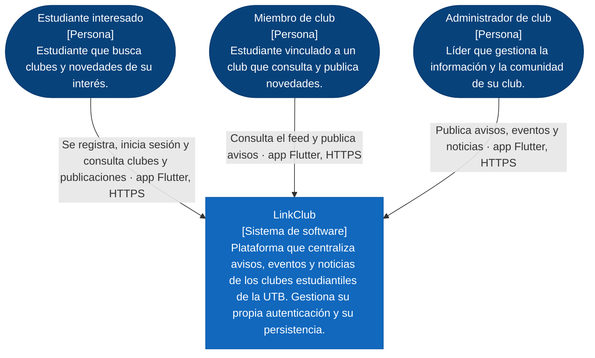
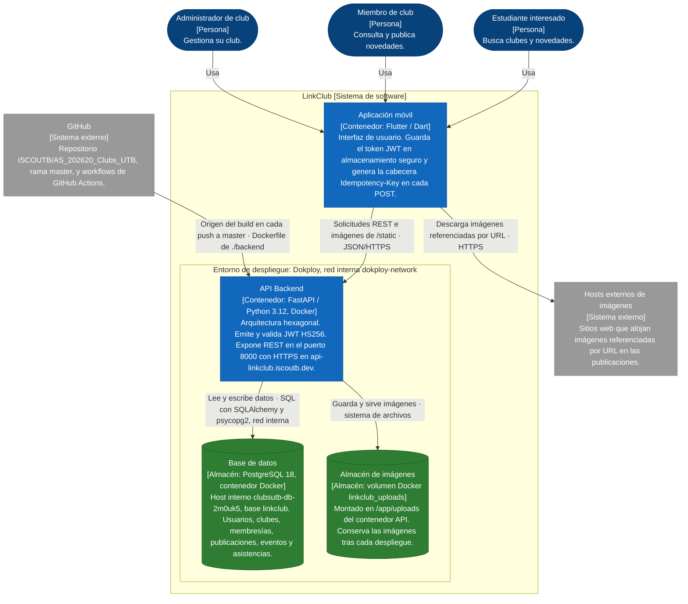

# C4 - Diagrama de Contexto

- Tipo: C4 nivel 1 (Contexto del sistema)
- Fecha de actualización: 2026-10-25
- Alcance: LinkClub como una sola caja, sus usuarios y los sistemas externos con los que se comunica en ejecución.
- Estado: vigente tras el ADR 0007. Supabase fue descartado; la autenticación y la persistencia son propias del sistema.

Leyenda

| Elemento | Significado |
|---|---|
| Óvalo azul oscuro | Persona que usa el sistema |
| Caja azul | Sistema de software que se documenta |

Notas

- El sistema no depende de ningún proveedor externo de identidad. El registro exige correo institucional (@utb.edu.co) y matrícula con formato T más 7 u 8 dígitos; el token JWT lo emite la propia API (ver ADR 0007).
- La consulta de clubes y publicaciones es pública en el contrato; toda escritura requiere sesión (escenario U3).
- Los sistemas externos de construcción y de contenido multimedia aparecen en el nivel 2, porque en ejecución solo interactúan con contenedores concretos.

# C4 - Diagrama de Contenedores

- Tipo: C4 nivel 2 (Contenedores)
- Fecha de actualización: 2026-10-25
- Alcance: unidades desplegables y almacenes de datos de LinkClub, y cómo se comunican.
- Entorno de despliegue: Dokploy (panel.iscoutb.dev), proyecto clubsutb, entorno production. API pública en https://api-linkclub.iscoutb.dev.

Leyenda

| Elemento | Significado |
|---|---|
| Óvalo azul oscuro | Persona |
| Caja azul | Contenedor desplegable propio |
| Cilindro verde | Almacén de datos propio |
| Caja gris | Sistema externo |
| Marco DOK | Entorno de despliegue en el servidor del laboratorio |

Notas

- La conexión a la base se hace por la red interna de Docker; el puerto 5432 no es parte del contrato de la aplicación.
- El TLS se termina en el proxy del dominio configurado en Dokploy (certificado Let's Encrypt). La API escucha en HTTP dentro de la red interna.
- El contenedor del volumen es un almacén de la API: ningún otro contenedor lo accede. La decisión de persistencia multimedia se documenta en el ADR 0009 (estrategia de persistencia multimedia).
- La imagen de PostgreSQL desplegada es postgres:18 (panel de Dokploy). El archivo deploy/compose.lab.yaml declara postgres:16-alpine y no es el que sirve la API vigente.
- Recursos: API y base con límite de 1 GB de memoria y 2 CPU, una réplica cada una.

# C4 - Diagrama de Componentes (API Backend)

- Tipo: C4 nivel 3 (Componentes del contenedor API Backend)
- Fecha de actualización: 2026-10-25
- Alcance: componentes de backend/src/linkclub y sus dependencias, con el estado real de implementación.

```mermaid
graph TD
    classDef entrada fill:#1168BD,stroke:#105EAB,color:#fff;
    classDef app fill:#438DD5,stroke:#3878B4,color:#fff;
    classDef puerto fill:#6C8EBF,stroke:#4A6FA5,color:#fff;
    classDef dominio fill:#08427B,stroke:#073B6F,color:#fff;
    classDef salida fill:#438DD5,stroke:#3878B4,color:#fff;
    classDef temporal fill:#438DD5,stroke:#F57C00,color:#fff,stroke-dasharray:5 5;
    classDef almacen fill:#2E7D32,stroke:#1B5E20,color:#fff;
    classDef externo fill:#999999,stroke:#888888,color:#fff;

    APP_MOVIL["Aplicación móvil<br/>[Contenedor: Flutter]"]:::externo
    OPER["Operador o pipeline<br/>[Consumidor externo]<br/>Verifica el estado del servicio."]:::externo
    DB[("PostgreSQL 18<br/>[Almacén: base linkclub]")]:::almacen
    FS[("Volumen linkclub_uploads<br/>[Almacén: /app/uploads]")]:::almacen

    subgraph API["API Backend [Contenedor: FastAPI / Python 3.12]"]
        subgraph ENT["Adaptadores de entrada - adapters/inbound/api"]
            R_HEALTH["health_router<br/>[Componente: Adaptador de entrada]<br/>GET /health."]:::entrada
            R_AUTH["auth_router<br/>[Componente: Adaptador de entrada]<br/>POST /auth/registro y POST /auth/login. Emite JWT HS256 con PyJWT."]:::entrada
            R_CLUB["club_router<br/>[Componente: Adaptador de entrada]<br/>GET /clubes con filtros q y categoria, y detalle por identificador."]:::entrada
            R_PUB["publicacion_router<br/>[Componente: Adaptador de entrada]<br/>POST y GET /publicaciones, y POST y GET por club. Lee la cabecera Idempotency-Key."]:::entrada
            R_REC["recurso_router<br/>[Componente: Adaptador de entrada]<br/>POST /recursos/upload. Valida la extensión y guarda la imagen. main.py monta /static."]:::entrada
            DEP_AUTH["auth_dependency<br/>[Componente: Dependencia de seguridad]<br/>require_auth extrae el Bearer token y devuelve la identidad. Responde 401 o 503."]:::entrada
        end

        subgraph APL["Aplicación - application"]
            UC_HEALTH["CheckHealthUseCase<br/>[Componente: Caso de uso]"]:::app
            UC_CLUB["ListarClubesUseCase y ObtenerClubUseCase<br/>[Componente: Caso de uso]"]:::app
            UC_PUB["CrearPublicacionUseCase<br/>[Componente: Caso de uso]<br/>Valida el tipo y las opciones de encuesta. Aplica idempotencia por clave."]:::app
            UC_NOT["NotificarPublicacionCreada<br/>[Componente: Caso de uso]<br/>Consumidor idempotente del mensaje publicacion.creada, deduplica por message_id."]:::app
            PT_STATUS["StatusPort<br/>[Puerto de salida]"]:::puerto
            PT_CLUB["ClubRepositoryPort<br/>[Puerto de salida]"]:::puerto
            PT_PUB["PublicacionRepositoryPort<br/>[Puerto de salida]<br/>obtener_por_idempotencia, guardar, listar_por_club."]:::puerto
            PT_AUTH["AuthPort<br/>[Puerto de salida]<br/>verificar devuelve el autor_id."]:::puerto
            PT_MSG["PublicadorPort, OutboxPort, DeduplicacionPort y NotificadorPort<br/>[Puertos de salida]"]:::puerto
        end

        subgraph DMN["Dominio - domain"]
            DOM_PUB["Publicacion<br/>[Componente: Dominio]<br/>Entidad, TipoPublicacion (aviso, encuesta, noticia) y PublicacionDuplicada."]:::dominio
            DOM_CLUB["Club<br/>[Componente: Dominio]<br/>Entidad y ClubNoEncontrado."]:::dominio
        end

        subgraph SAL["Adaptadores de salida - adapters/outbound"]
            AD_PUB["PublicacionRepositoryPostgres<br/>[Componente: Adaptador de salida]<br/>Persiste y consulta publicaciones."]:::salida
            AD_JWT["LocalJwtAuthAdapter<br/>[Componente: Adaptador de salida]<br/>Verifica firma HS256, exp y sub con PyJWT."]:::salida
            ORM["Acceso a datos SQLAlchemy<br/>[Componente: Adaptador de salida]<br/>database.py y modelos Usuario, Club y Publicacion. Sesión por petición con get_db."]:::salida
            AD_STATUS["InMemoryStatusAdapter<br/>[Componente temporal]<br/>Devuelve ok fijo, sin sondear la base."]:::temporal
            AD_CLUB["InMemoryClubAdapter<br/>[Componente temporal]<br/>Semilla de cinco clubes en memoria."]:::temporal
            AD_MSG["InMemoryBroker, InMemoryOutbox e InMemoryDedup<br/>[Componente temporal]<br/>Simulan broker con reintentos y DLQ. Sin endpoint que los invoque; cubiertos por test_mensajeria.py."]:::temporal
        end
    end

    APP_MOVIL -->|"POST /auth/registro y /auth/login · JSON/HTTPS"| R_AUTH
    APP_MOVIL -->|"GET /clubes · JSON/HTTPS"| R_CLUB
    APP_MOVIL -->|"GET y POST /publicaciones · JSON/HTTPS"| R_PUB
    APP_MOVIL -->|"POST /recursos/upload y GET /static · HTTPS"| R_REC
    OPER -->|"GET /health · HTTPS"| R_HEALTH

    R_PUB -->|"Exige token en escrituras"| DEP_AUTH
    DEP_AUTH -->|"Invoca"| PT_AUTH
    PT_AUTH -.->|"Implementado por"| AD_JWT

    R_HEALTH -->|"Invoca"| UC_HEALTH
    R_CLUB -->|"Invoca"| UC_CLUB
    R_PUB -->|"Invoca"| UC_PUB

    UC_HEALTH -->|"Usa"| PT_STATUS
    UC_CLUB -->|"Usa"| PT_CLUB
    UC_CLUB -->|"Usa reglas de"| DOM_CLUB
    UC_PUB -->|"Usa"| PT_PUB
    UC_PUB -->|"Usa reglas de"| DOM_PUB
    UC_NOT -->|"Usa"| PT_MSG

    PT_STATUS -.->|"Implementado por"| AD_STATUS
    PT_CLUB -.->|"Implementado por"| AD_CLUB
    PT_PUB -.->|"Implementado por"| AD_PUB
    PT_MSG -.->|"Implementado por"| AD_MSG

    AD_PUB -->|"Usa sesión"| ORM
    ORM -->|"Lee y escribe datos · SQL, red interna"| DB

    R_AUTH -.->|"Acceso directo a la sesión de base de datos"| ORM
    R_PUB -.->|"Listados y resolución de autor, acceso directo"| ORM
    R_REC -.->|"Escribe imágenes · sistema de archivos"| FS
```

Leyenda

| Elemento | Significado |
|---|---|
| Caja azul intenso | Adaptador de entrada |
| Caja azul medio | Caso de uso o adaptador de salida operativo |
| Caja azul grisáceo | Puerto (interfaz) |
| Caja azul oscuro | Entidad de dominio |
| Caja con borde naranja discontinuo | Componente temporal: implementación en memoria, pendiente de reemplazo |
| Cilindro verde | Almacén de datos |
| Caja gris | Elemento externo al contenedor |
| Flecha continua | Dependencia o llamada directa |
| Flecha punteada | Implementación de un puerto, o acceso directo que omite el puerto |

Desviaciones declaradas respecto al estilo hexagonal (ADR 0001)

| Componente | Desviación | Efecto |
|---|---|---|
| auth_router | Usa la sesión SQLAlchemy y las constantes JWT directamente, sin caso de uso ni puerto. | La lógica de registro y login no es aislable en pruebas unitarias. |
| publicacion_router | Las consultas de listado y la resolución del autor se hacen contra la sesión, sin pasar por el puerto. | Cambiar de motor de persistencia obligaría a tocar el adaptador de entrada. |
| recurso_router | Escribe en el sistema de archivos sin puerto de almacenamiento. | La persistencia multimedia queda acoplada al volumen local (ver ADR 0009). |
| club_router | Instancia directamente InMemoryClubAdapter. | El catálogo de clubes no proviene de la tabla clubes. |
| health_router | El estado es fijo, sin verificar la conexión a la base. | El escenario U2 no queda cubierto con una comprobación real. |

Estado de implementación por componente

| Contexto | Implementado | Pendiente |
|---|---|---|
| Usuarios | Registro, login, emisión y validación de JWT | Perfil (GET /usuarios/me), roles por membresía |
| Clubes | Listado y detalle con datos en memoria | Persistencia en PostgreSQL, creación, membresías |
| Publicaciones | Creación y listado con persistencia, idempotencia por clave, imagen asociada | Control de rol por club (403), tipo noticia verificado de extremo a extremo |
| Eventos y asistencia | Tablas en la migración 001 | Casos de uso, routers y contrato implementado |
| Mensajería | Mensaje versionado, outbox, broker simulado y consumidor idempotente | Conexión a un endpoint y a un transporte real |

# Trazabilidad

| Elemento | Referencia |
|---|---|
| Estilo arquitectónico | docs/adr/0001-hexagonal.md |
| Integración REST y contrato | docs/adr/0003-integracion-rest-openapi.md, docs/api/openapi.yaml |
| Migración a Dokploy y PostgreSQL, descarte de Supabase | docs/adr/0007-migracion-dokploy-postgresql.md |
| Decisión de no extraer Publicaciones | docs/adr/0008-no-extraer-publicaciones.md |
| Persistencia multimedia | docs/adr/0009-estrategia-persistencia-multimedia.md |
| Despliegue | docs/arc42/07_vista_de_despliegue.md y deploy/compose.lab.yaml |
| Contextos y propiedad de datos | docs/arc42/mapa-contextos-fundamentacion.md, docs/arc42/tabla_modulo.md |
| Pruebas | backend/tests/test_auth.py, test_contrato_openapi.py, test_publicaciones.py, test_clubes.py, test_mensajeria.py, test_health.py |

# Historial de cambios

| Fecha | Cambio |
|---|---|
| 2026-10-25 | Se elimina Supabase de los tres niveles. Se incorporan PostgreSQL 18 y el volumen linkclub_uploads como almacenes, el entorno Dokploy, GitHub y los hosts de imágenes como externos, y los componentes reales del backend con sus desviaciones. |